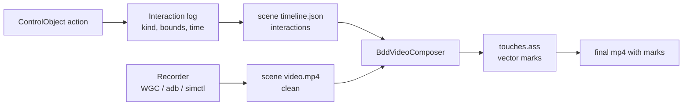

# Proposal: Show Taps And Swipes In Recorded Videos

Status: proposal, 2026-10-06. Nothing is implemented yet.

## Problem

In the module videos it is often unclear which button was pressed, or whether a swipe
happened. The screen simply changes. A mouse cursor is not the answer:

- On Windows, MAUI tests use no physical input (AD-005). Clicks go through UI Automation
  patterns or the gesture bridge (AD-008), so a real cursor never moves.
- Android (`adb screenrecord`) and iOS recordings have no cursor at all.
- A swipe on Windows is a semantic bridge verb. Nothing on screen moves until the content
  itself moves.

We need one way to show touches that looks the same on Windows, Android and iOS.

## Proposal In One Sentence

Each interaction is logged on the test side, on the recording clock, with its target's bounds.
The video composer then draws touch marks on top of the recorded frames.



## Why This Approach

| Option | Verdict | Reason |
| --- | --- | --- |
| Draw marks at compose time from logged interactions | **Chosen** | Works on every platform, needs no app change, and adds no input. The composer can draw a mark slightly *before* the action, so the viewer sees it before the screen changes. |
| Overlay drawn by the app (MAUI adorner or tap ripple) | Rejected | It is app-side automation behaviour, which fails the AD-008 admission tests. The app does not know which tap was a test step, and timing depends on the UI thread. |
| Show a real mouse cursor | Rejected | Windows MAUI has no physical input (AD-005), and phones have no cursor. |
| Android "Show taps" (`show_touches`) | Rejected as the main route | Android only, a dot without context, nothing for swipes made by the bridge, and nothing on iOS or Windows. It stays off, to avoid double marks. |
| Edit the videos by hand afterwards | Rejected | Recordings are reproducible gate runs (AD-024). Manual edits drift with every rerecording. |

## What Is Logged

A new record goes into each scene's `timeline.json`, next to `steps` and `clips`:

```json
"interactions": [
  {
    "kind": "Tap",
    "at": 12.48,
    "duration": 0,
    "bounds": { "x": 1012, "y": 88, "width": 44, "height": 44 },
    "from": null,
    "to": null,
    "label": "ContactList_btnAdd",
    "step": 7
  },
  {
    "kind": "Swipe",
    "at": 20.10,
    "duration": 0.4,
    "bounds": { "x": 0, "y": 140, "width": 1280, "height": 620 },
    "from": { "x": 640, "y": 220 },
    "to": { "x": 640, "y": 520 },
    "label": "ContactList_RefreshView",
    "step": 11
  }
]
```

- **`kind`:** `Tap`, `DoubleTap`, `LongPress`, `Swipe` (with a direction derived from
  `from`/`to`), `Type`, `Clear`, `Key` (Enter, Back) or `Navigate` (back navigation without a
  target).
- **`at`:** seconds on the scene's video clock (the same `Stopwatch` clock as steps; AD-024).
  Taken just **before** the action runs, while the screen still shows the old state.
- **`bounds`:** the target element's rectangle, read before the action, because the element
  can disappear afterwards. Coordinates are in **video pixels**; see below.
- **`label`:** the AutomationId or accessible name, for debugging. It is never drawn.

### Where Interactions Are Captured

Brinell owns the hook. Construction tests change nothing.

- A reporting decorator around `IMauiElement` (`Click`, `DoubleClick`, `LongPress`, `Swipe`,
  `SendKeys`, `Clear`, `PerformGesture`) and `IMauiDriver.PerformGesture`. It reads `Rect`, then
  calls the inner element.
- The decorator is installed only while a recording is running, exactly like
  `BddExecutionContext.Pacer`. A plain `dotnet test` run has no decorator and no cost (an
  AD-024 "broken when" rule).
- The log is a small `IInteractionLog` in `Brinell.Core.Recording`. It is platform-neutral
  (AD-001): rectangles and points only.
- `ScrollIntoView` is not logged. It is an implementation detail, and a mark for it would be
  noise.

### Mapping Coordinates To The Video

| Head | Element coordinates | Video | Mapping |
| --- | --- | --- | --- |
| Windows (FlaUI) | UIA screen pixels | Window client area through Windows.Graphics.Capture | Subtract the captured window's origin, which the recorder stores at start. DPI is physical on both sides. |
| Android (Appium) | Device pixels | `adb screenrecord`, device pixels, possibly scaled | Scale by `videoWidth / deviceWidth`. |
| iOS (Appium) | Points | Simulator recording in pixels | Scale by `videoWidth / windowWidthInPoints`. |

The recorder writes its origin and source size into the scene timeline (`origin`, `sourceWidth`,
`sourceHeight`), so the composer does the mapping. The log stays in raw element coordinates.

## How Marks Look

All marks are drawn as an **ASS subtitle track with vector drawings** and burned in with
ffmpeg's `subtitles` filter (libass). ASS gives shapes, positions, `\move` for motion, `\t`
for scale animation and `\fad` for fades, all in one text file the composer generates. That
file can be unit-tested as text.

Every mark is a **white stroke with a dark outer halo** (or the reverse for the fill), so it
reads on both light and dark screens. Sizes scale with the video's short side, so phone and
desktop videos look the same.

| Interaction | Mark | Timing |
| --- | --- | --- |
| Tap | A ring closes onto the touch point. Then a filled dot plus a ripple expands and fades. The target's bounds get a thin rounded outline. | Ring closes over 250 ms **before** `at`, ripple 400 ms after `at`. Outline from `at - 250 ms` to `at + 400 ms`. |
| Double tap | Two ripples, 120 ms apart. | As for Tap. |
| Long press | A dot holds while a ring grows around it, then a ripple. | From `at` for `duration`, then the ripple. |
| Swipe | A dot travels from `from` to `to`, leaving a fading trail (3-4 smaller dots). An arrow appears at the end. | Travel over 400 ms, ending at `at`, because the bridge swipe is instant. On Android/iOS, over the real gesture's duration. |
| Pull to refresh | The same as Swipe (down) over the list. | As for Swipe. |
| Type / Clear | The field's bounds get an outline. A small chip shows a keyboard icon (no text: the text appears on screen). | While typing, minimum 400 ms. |
| Key (Enter) / Back | A chip in the bottom corner: "⏎ Enter" or "← Back". | 600 ms. |

The touch point is the centre of `bounds`, except for swipes, which use `from`/`to`. The
composer also adds:

- **Pre-roll:** because marks are drawn afterwards, a tap's ring can start 250 ms before the
  action. The viewer sees *what* will be pressed while the screen still shows it. This needs no
  waiting in the test.
- **Lead (optional):** if a step follows the previous one too quickly for the pre-roll to land
  on a still frame, the recording pacer can wait an extra `Lead` (default 0, script field
  `Lead`). This happens only during recording, as the beat already does.

## Video Script Switch

A `*.video.md` header field controls marks. The default is on:

```markdown
| Touches | on |       <!-- on | off | outline-only -->
```

Raw scene videos (`<script>.scenes/scene-NN/video.mp4`) **stay clean**. Marks are added only
when the scenes are composed or stitched. As a result:

- a scene does not need rerecording to change the style or to turn marks off;
- a scene's hash does not include `Touches`, which only affects composition;
- the timeline keeps the facts, and the pixels of a raw scene never hold derived drawing.

## Effect On The Brinell Decisions

| Decision | Effect |
| --- | --- |
| AD-005 (no physical input) | Unchanged. Nothing moves a pointer. |
| AD-008 (gestures through UIA and the bridge) | Unchanged. No new app-side bridge verbs or sinks. The app is not touched. |
| AD-024 (recording is a paced gate run) | Extended: the timeline gains `interactions`, and the recorder writes its origin and source size. "Nothing is burned in" must be refined: **captions** stay a separate `.srt`, while touch marks are drawn into the *composed* video only. Raw scenes stay clean. This needs an AD-024 amendment before implementation. |
| AD-001 (core is platform-neutral) | The log lives in `Brinell.Core.Recording` with `System.Drawing` rectangles only. |

## Implementation Steps (Brinell)

1. **Log:** `IInteractionLog` and `BddTimedInteraction` in `Brinell.Core.Recording`, plus an
   `interactions` field in `BddSceneTimeline`, with JSON round-trip tests.
2. **Capture:** a reporting `IMauiElement`/`IMauiDriver` decorator, installed when the scene
   recording starts. Unit tests check that each action logs one interaction, with its bounds
   read before the action, and that nothing is logged without a recording.
3. **Mapping:** recorders write `origin`, `sourceWidth` and `sourceHeight`. Windows reads the
   captured window's client origin, Android the `wm size`, iOS the window size in points.
4. **Drawing:** `TouchOverlay` generates the `.ass` file from the timeline. Text-snapshot tests
   cover each kind (tap, swipe, long press, type, back) and the scaling.
5. **Compose:** `BddVideoComposer` adds `-vf subtitles=touches.ass` when `Touches` is not `off`.
   Fall back to no marks, with a warning, when ffmpeg lacks libass.
6. **Script:** the `Touches` header field, with a checker rule (`VID0xx`) for invalid values.
7. **Docs:** the AD-024 amendment, and a short section in `docs/guides/narrated-recordings.md`.

## Verification In Construction

- Rerecord `contacts-in-a-minute` and `contacts-walkthrough` with
  `scripts/record-module-video.ps1`.
- Check in the video:
  - every tap on the list, the sheet buttons and the New button shows a ring and a ripple on
    the right control;
  - pull to refresh shows a downward swipe over the list;
  - the marks are visible on light pages and dark headers;
  - the marks appear before the screen changes.
- Compare the `interactions` in `timeline.json` with the steps: one mark per action, and no
  marks for `ScrollIntoView`.
- Later: one Android recording of the same script, to confirm the device-pixel mapping.

## Open Questions

1. **Burned in or a second file?** Burn the marks into the main mp4 (the proposal), or produce
   `video.mp4` plus `video.touches.mp4`?
2. **Typing:** show only the outline and a keyboard chip (the proposal), or also the typed text
   in the chip, for fields that mask input?
3. **Lead:** keep `Lead` at 0 by default and rely on pre-roll, or default to around 150 ms
   when recording?
4. **Colour:** neutral white/dark (the proposal), or the Exact accent colour with a halo?
