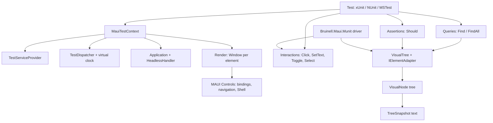

# MUnit: a bUnit for .NET MAUI, and a Bruinell head on it

A proposal with a working proof of concept, 2026-10-25. MUnit (a temporary name) renders MAUI
pages, views and view models in memory inside a unit test. It drives them through the controls' own
entry points and asserts on what a user would see. It needs no emulator, simulator, WinUI host or
device runner, and it works under xUnit, NUnit and MSTest. `Bruinell.Maui.Munit` puts Bruinell's
existing MAUI page objects on top of it. The API, interfaces and internals are in
[design.md](design.md); the facts it rests on are in [findings.md](findings.md).

## Outcome

It is feasible, and the proof of concept is green:

| Suite | Tests | What it covers |
| --- | --- | --- |
| `MUnit.Tests` (xUnit) | 41 | The six example kinds; the dispatcher, virtual clock, tree, errors and parallel contexts; Shell chrome, swipes, focus and dialogs |
| `MUnit.Tests.NUnit`, `MUnit.Tests.MSTest` | 2 + 2 | The same API under the other two frameworks |
| `Bruinell.Maui.Munit.Tests` | 3 | The sample app's real XAML pages, driven by the device suite's page objects, unchanged |
| `Bruinell.Maui.UITests` with `BRUINELL_HEAD=munit` | 325 pass, 35 skip, 0 fail | The whole MAUI device suite on both sample apps compiled headless; what skips needs a device ([suite-count.md](suite-count.md)) |

Each MUnit suite runs in about 0.2 s, and the device suite in 6 s. The pages are real MAUI: XAML
compiled by XamlC, compiled bindings, `Command`, `NavigationPage`, Shell routes and `CollectionView`.

The key finding is that MAUI needs much less platform than expected. Controls, bindings, triggers,
navigation and Shell all run on the plain `net10.0` assemblies. They need only three things:
- a dispatcher;
- a `Window` that belongs to an `Application`;
- one service-carrying handler, on a Shell only.

MUnit supplies those and leaves the rest to MAUI. It reimplements nothing: no binding engine, no
navigation, no lifecycle.

## What carries over from bUnit, and what cannot

| bUnit | MUnit | Why it differs |
| --- | --- | --- |
| `BunitContext` with `Services`, fixed at first render | `MauiTestContext` with `Services`, fixed at first render | Same |
| `Render<TComponent>()` returning `IRenderedComponent<T>` | `Render<TPage>()` returning `IRenderedElement<T>` | A view or layout is put on a page of its own |
| A renderer that diffs and re-renders | None; MAUI's elements are the live tree | MAUI has no render tree; bindings change properties in place |
| Markup (AngleSharp DOM) and `Find(css)` | `VisualNode` tree and `Find<T>(automationId)` | No markup exists; type, `AutomationId` and text are what MAUI tests select by |
| `MarkupMatches` semantic HTML compare | Indented-text tree snapshot (Phase 5) | Same intent: a readable, diffable picture of the screen |
| Event dispatch (`Click()` fires `onclick`) | Control entry points (`Button.SendClicked`, `Entry.SendCompleted`) | MAUI events are raised by controls, not dispatched through a DOM |
| Renderer dispatcher, `WaitForState`, `WaitForAssertion` | `TestDispatcher` queue, the same two waits, and a virtual clock | MAUI apps use `IDispatcher` timers; virtual time makes them deterministic |
| Fake `NavigationManager` | MAUI's own `NavigationPage` and Shell | They work headless; a fake would only drift from them |
| JS interop in loose or strict mode | Nothing to fake | There is no script |
| Fake authorization | None | MAUI has no framework auth; apps inject their own service, which tests replace |

What cannot carry over is the one-tree model. In bUnit the rendered markup is the whole truth. In
MAUI, what is on screen also depends on handlers (measure, layout, virtualization) that MUnit does
not run. So MUnit is honest about three gaps:
- There is no layout: no sizes, positions or clipping.
- Items views are fully realized, with no virtualization.
- A device-only question throws instead of guessing.

## Architecture

There are six layers, as the brief asked for:
1. **Host.** `MauiTestContext` holds the services, a dispatcher with a virtual clock, in-memory preferences and secure storage, and an `Application`.
2. **Renderer.** `Render<T>` makes the element from the services, puts it in a `Window` opened in that application, and calls `SendAppearing`. MAUI then runs its own lifecycle.
3. **Tree.** `VisualTree` reads `VisualNode`s through `IElementAdapter`s. It descends to what the window shows: the top modal, the current navigation page, the Shell's page, the realized rows and the toolbar.
4. **Interaction.** Extension methods call each control's own entry point on the dispatcher. They refuse hidden, disabled and read-only targets.
5. **Assertions.** `Should()` reads the node. A failure prints the element's line and the screen.
6. **Snapshots.** `TreeSnapshot` already formats the tree deterministically. Snapshot files and their approval are Phase 5.

## Decisions taken in the proof of concept

- **Reuse MAUI's binding engine.** It works headless once a dispatcher exists. Writing our own would be slower to build and would differ from the device.
- **Bindings apply at once, dispatched work at the next MUnit call.** `IsDispatchRequired` is false. Work posted through `Dispatch`, async continuations and async void handlers run when the queue drains, which happens at every render, interaction, query, assertion and wait. A test never sleeps, and an async void handler's exception fails the test instead of the process.
- **Virtual time.** `DispatchDelayed` and `IDispatcherTimer` run only when a test calls `AdvanceTime`. A countdown test takes microseconds and gives the same result every run.
- **Strict `Find`.** Exactly one match is required, otherwise the error lists the tree. `FindAll` is for many. bUnit returns the first match; strictness catches ambiguous tests early.
- **Interactions refuse what a user could not do.** A hidden or disabled element throws `ElementNotInteractableException`. A button whose command cannot execute counts as disabled, because MAUI disables it.
- **No test-framework dependency.** Assertions throw `MUnitAssertionException`, which all three frameworks report as a failure with its message.
- **`Application.Current` is set only while a context runs its work.** It is process-wide, and `Shell.Current` and resource lookups read it. A lock keeps parallel contexts correct; `SetApplicationCurrent = false` removes that serialization for apps that never read it.
- **The Bruinell head reports `MauiPlatform.Windows`.** Bruinell's driver defaults are the UI Automation answers, and MUnit's tree behaves like that one. A `Headless` value is open below.

## Handler strategy

Controls get no handlers in V1. This is what that means for each concern:

| Concern | Handler needed? | V1 | Later |
| --- | --- | --- | --- |
| Properties, bindings, triggers, styles, visual states | No | MAUI's own code | Nothing to do |
| Commands, events, two-way updates | No | Control entry points | Nothing to do |
| Page lifecycle, NavigationPage, modals | No; needs a Window in an Application | Host | Nothing to do |
| Shell `ContentTemplate` pages | A services carrier on the Shell | `HeadlessHandler` (no mapping) | Nothing to do |
| `Measure` and `Arrange`, bounds, `SizeChanged` | Yes: `GetDesiredSize` | None: zero sizes | Phase 6: fake leaf handlers with a text-length sizer, real layout managers above them |
| `Loaded` and `Unloaded`, `IsLoaded` | Yes: platform view attach | Not raised | Phase 6: raise them on render and dispose |
| Focus | Yes, for `Focus()` | `SetFocus` and `ClearFocus` set MAUI's own `IsFocused` key | Nothing to do |
| Keyboard, `ScrollView.ScrollToAsync` | Yes | Not supported | Phase 6 fakes that record and complete |
| `DisplayAlert`, `DisplayActionSheet`, `DisplayPromptAsync` | Yes: AlertManager over the window handler | Taken from the page and shown as a `TestDialog`; its buttons answer the app | Nothing to do |
| Shell's tab bar and flyout | Yes: the platform draws them | `ShellTabBar` and `ShellFlyoutList` nodes; selecting one sets the Shell's current item | Nothing to do |
| `WebView`, `Map`, `GraphicsView` drawing, `MediaElement` | Yes, and fully platform | Out of scope | Device heads only |

So there are three groups:
- **Omitted:** everything that only draws or measures.
- **Faked later:** the leaf views' `GetDesiredSize`, plus keyboard and scroll.
- **Shown as a user sees them, without a handler:** dialogs and Shell chrome, read from MAUI's own state.

## Feasibility and risks

- **Internals.** MUnit calls six MAUI internals by reflection:
  - `Application.AddWindow` and `RemoveWindow`;
  - `TapGestureRecognizer.SendTapped`;
  - `BindableObject.GetContext`, which backs `BeBoundTo`;
  - `VisualElement.IsFocusedPropertyKey`, for focus;
  - `Page._pendingActions`, where the dialog requests wait.

  They live in one class, `MauiInternals`, and a missing one fails with its name. Each MAUI upgrade needs one run of MUnit's suite. That risk is real but small, and MAUI's own unit tests rely on the same members.
- **Static Essentials.** `Preferences.Default`, `MainThread` and `Connectivity.Current` throw on the plain TFM. Apps that inject `IPreferences`, `IDispatcher` and the rest (MAUI's own guidance) test cleanly; apps that call the statics have to change first. This is the biggest adoption cost.
- **False passes.** A page that only fails on layout (clipped text, a button pushed off screen) passes here. The device heads stay the judge at a gate, as with the bUnit head.
- **Grouped `CollectionView` and `ListView` cells** are not realized yet. A `CarouselView` shows only its current card, as a phone does; Windows reports every card as on screen, which is the one known difference in the suite's count.
- **Parallel speed.** With `SetApplicationCurrent` on, contexts take turns running MUnit work. Each turn takes microseconds, so measured suites are not slowed. A heavy `OnAppearing` would be.

## Roadmap

1. **Visual tree inspection.** Done in the proof of concept: tree, queries, effective state, realized rows, toolbar, errors. Remaining: grouped items, `ListView`, `FlyoutPage` and `TabbedPage` tests.
2. **Interaction simulation.** Done for buttons, taps, text, toggles, ranges, pickers, dates, selection, refresh, swipes (SwipeView, CarouselView, RefreshView, recognizers) and focus. Remaining: drag and drop, pan and pinch without an app sink.
3. **Binding assertions.** `BeBoundTo` and `HaveBindingContext` are done. Remaining: binding failures captured as test failures (MAUI's binding diagnostics), and the converter and `StringFormat` in messages.
4. **Navigation testing.** Done: NavigationPage, modals, Shell routes, Shell's tab bar and flyout, and alerts, prompts and action sheets. Remaining:
   - `ShellNavigationQueryParameters` assertions;
   - back-button handling (`OnBackButtonPressed`).
5. **Snapshot testing.** The formatter is done. Remaining: `ShouldMatchSnapshot()` with `__snapshots__/<Test>.txt` beside the test, a `.received.txt` on mismatch, and an accept switch (environment variable), as Verify does. Design in [design.md](design.md).
6. **Optional handler integration.** Fake leaf handlers with a sizer, so `Measure`, bounds, `Loaded` and `SizeChanged` work. This is off by default, because it costs speed and determinism.

For Bruinell, the head follows the bUnit head's plan:
1. Done: the device suite runs on MUnit, 319 of 354 in 6 s; the other 33 are device-only or platform media, and one is a known difference ([suite-count.md](suite-count.md)).
2. Done: a head choice in `MauiTestFixtureBase` (`BRUINELL_HEAD=munit`, the fixture's `CreateInMemoryOptions`), with `DeviceFact`, `WindowsOnlyFact(Device = ...)` and `@device` skipped on MUnit.
3. Write a decision record once the owner has seen the counts.

## Open questions, each with a proposal

- **The name.** "MUnit" collides with Scala's MUnit test library. Proposal: `Bruinell.Maui.Headless` for the framework, keeping `Bruinell.Maui.Munit` only if the owner prefers the bUnit echo.
- **A `MauiPlatform.Headless` value.** Proposal: not yet. Every exhaustive switch on the platform would need a case, and Windows semantics fit today. Revisit after the sample suite's count.
- **Where MUnit lives.** It is in Bruinell's `srcnew` for now. Proposal: keep it there until it has its own users; it depends on nothing from Bruinell, so it can move out unchanged.
- **Default for `SetApplicationCurrent`.** Proposal: keep it on. Correctness beats a parallel speed-up nobody has measured a need for.
