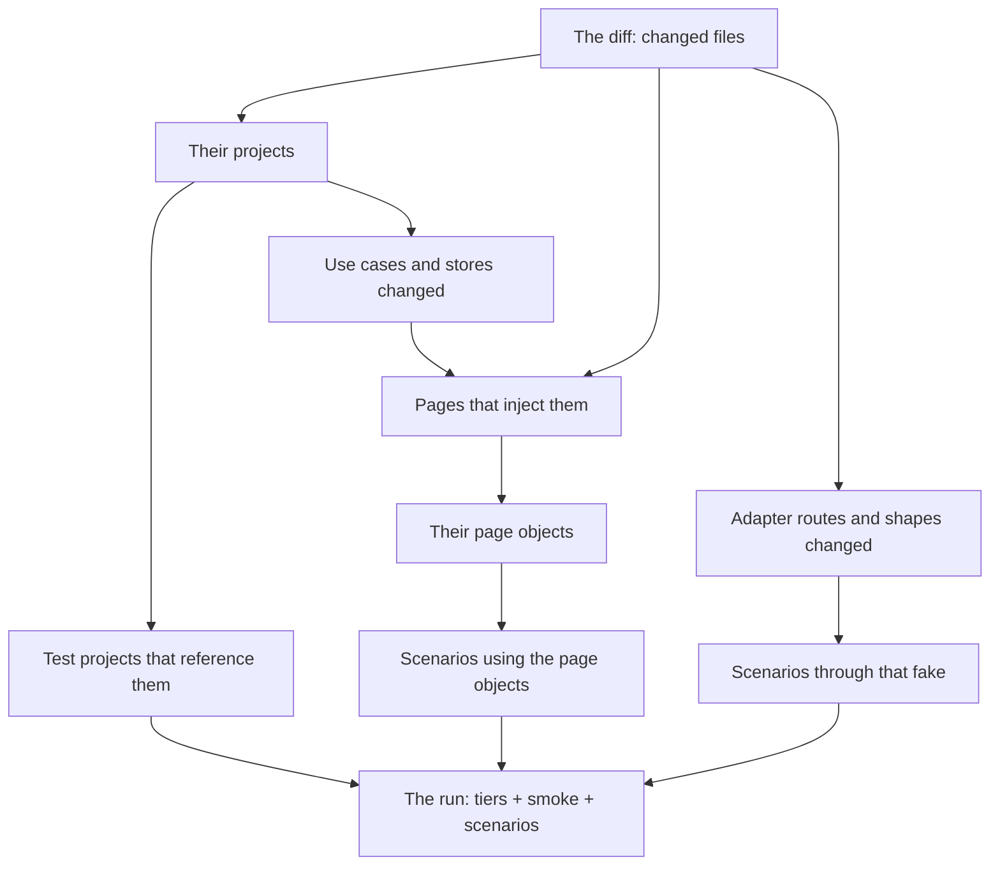

# Which tests a change runs: the workflow

A workflow, 2026-10-25, on Tomorrow's suites as the example: how a change is traced to the tests that can see it.
It sits beside the research [paper](paper.md), whose touch map (the tests' recorded page and control calls) is the
other way to find the same links; [samples-and-stacks.md](samples-and-stacks.md) carries it to the other stacks.

A change runs the tests that can see it, worked out from the diff, not picked by hand. Today a review picks its
tiers by folder and its UI scenarios by name, and that missed a break on 2026-10-25: tool runs moved to Foundry's
Responses route in the studio's adapters, the AI test passed, and nine studio scenarios failed only at the A68
checkpoint, because the UI suites' fake Foundry answered the old route alone. This design says how a change is
traced to its tests, so a step's review runs what it touched, and only that.

## 1. A change in the code

Every change lands in one of three kinds of code. What it can break, and so which tests see it, follows from the
kind.

| Kind | Where in Tomorrow | Seen by |
| --- | --- | --- |
| Frontend | Blazor pages and components (`Tomorrow.App`, `Tomorrow.Studio`, `Tomorrow.Web`), their CSS and JS | the UI scenarios that open the page, through its page object |
| Backend | rules and use cases (`Tomorrow.Game`, `Tomorrow.Studio.Core`), stores and migrations (`Tomorrow.Data`, the studio's stores) | its project's unit or integration tests, and the UI scenarios whose pages call the use case |
| Service | what talks to the outside or runs apart: the model adapters (`Tomorrow.AI`, the studio's bench models), the call queue's runners, the art tool, the importer | its contract tests, and the UI scenarios that go through the fake standing in for the outside |

- **Frontend** breaks what a person sees: a page that no longer renders, a test id gone, a layout that hides a
  button. Only a UI scenario sees it.
- **Backend** breaks a rule or a stored row. A unit test sees the rule; a UI scenario sees it only when a page uses
  that rule.
- **Service** breaks a contract with something outside: a route, a request's shape, an answer's shape. The real
  outside is never called in tests, so the fakes stand in, and a change to the contract must change the fake too.
  The scenarios that pass through the fake are the only ones that see the contract whole.

## 2. Working out which tests to run

The tests a change runs are found in four steps, each from something the repository already holds. A script
(`tools/Select-Tests.ps1` in Tomorrow, Brinell's selection later) does it from `git diff <base>..HEAD` and prints the `dotnet test` filters with a line on
why each test is in.

1. **Projects.** Each changed file's project, then every test project that references it, directly or through
   another project (the `.csproj` references). That sets the unit, integration, AI contract and art tiers.
   `Tomorrow.Architecture.Tests` always runs: it is seconds long and guards the rules.
2. **Pages.** A changed page or component is its own; a changed use case or store reaches the pages that inject it
   (`@inject`, the use cases a page holds), and a component reaches the pages that draw it.
3. **Scenarios.** A page maps to its page object by its test ids' prefix (`WorldPage_…` to `WorldPlacesPage`);
   the page object maps to the scenarios that use its phrases (Brinell's `find_step_usages`), and to the UI test
   classes that build it. Those scenarios run, with the smoke set (`Gate=Smoke`) always.
4. **Contracts.** A changed adapter route or request shape (`/openai/v1/…`, Meshy's, the importer's sources) maps to
   the fake that mirrors it (`FakeFoundry`'s routes, by the marker each scenario's prompt starts with) and the
   scenarios that pass through it. A changed fake runs every scenario through it.

Some code is shared so widely that tracing it is not worth it: the service registration, `DatabaseSetup`,
`TomorrowApp`, the fakes, `BenchFrame`, the game screen's layout. A change there runs both UI suites whole, as a
checkpoint does.

## 3. What runs when, and what a miss teaches

| When | What runs | Why |
| --- | --- | --- |
| A task, as it is built | the selection for the task's own diff | seconds to a few minutes, so building stays fast |
| A step's review | the selection for the step's whole diff, from its base | everything the step touched, once |
| A checkpoint, an SDLC review, before an unattended run ends | every tier and both UI suites whole | catches what the tracing missed |

- A test that fails at a checkpoint but was not selected at the review that touched its code is a miss. The review
  names the link the tracing lacked (the 2026-10-25 miss: an adapter's route to the fake's), and the script learns
  it, so the next change of that kind selects the test.
- A selection is printed with its reasons in the review's Tests table, so the owner sees what ran and why.
- A test that fails under load and passes alone is flaky, as today: noted, not counted as a miss.

## Open

- **Item 3 of the outline was left open by the owner.** Proposed here: what runs when, and how a miss teaches the
  selection. Why: the first two items say how a test set is found; this one says when it is enough.
- **The script or the review's judgement.** Proposed: the script selects and the review may add, never remove; the
  added tests and why go in the Tests table. Why: the tracing is only as good as its links, and a reviewer knows a
  link the script lacks.
- **Where the links live.** Proposed: no map file kept by hand; the script reads the project references, the
  `@inject` lines, the test id prefixes, the page objects' phrases and the fakes' routes as they are in the code.
  Why: a hand-kept map drifts, the way Tomorrow's `layout.md` did.
- **Traced or recorded.** This workflow traces the links from the code; the [paper](paper.md)'s touch map records
  them from a full run. Proposed: the touch map for pages and scenarios, since it sees what a test really did, and
  the tracing for what a run cannot record: project references and the fakes' contracts.
