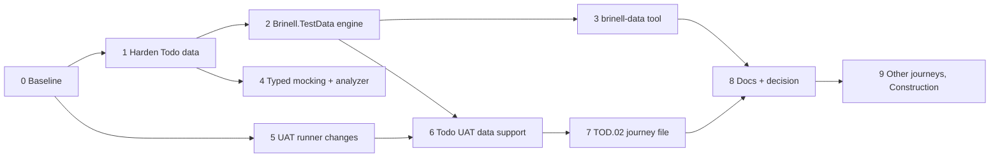

# Implementation plan: test data + journey UAT files

Status: phases 0-8 implemented; phase 9 (other journeys, Construction) open (see [AD-012](../../.docs/decisions/ad-012-test-data-is-typed-validated-and-chosen-by-the-scenario.md) and [Test Data](../../docs/guides/test-data.md))
Date: 2026-09-24
Implements:

- [test-data-proposal.md](https://github.com/exact-mobile-apps/test-tooling/blob/7162ac7/.my/uat/test-data-proposal.md) - decisions D1-D8
- [tod-02-single-journey-uat.md](https://github.com/exact-mobile-apps/test-tooling/blob/7162ac7/.my/uat/tod-02-single-journey-uat.md) - one `.uat.md` per journey
- [todo-test-data-example.md](https://github.com/exact-mobile-apps/test-tooling/blob/7162ac7/.my/uat/todo-test-data-example.md) - the target end state for TOD.02

The phases are ordered by dependency. Each phase ends green and can be committed on its own.
Phases 4 and 5 do not depend on 2-3 and can be done in parallel with them.

Commands are from the Brinell root unless marked `(samples/Todo)`.

---

## Phase 0 - Baseline

Goal: know what green looks like before anything changes.

| Step | Do | Verify |
| --- | --- | --- |
| ✅ 0.1 | Build the Brinell solution and the Todo app | `dotnet build srcnew\Brinell.sln -v:minimal /nr:false`; `(samples/Todo)` `dotnet build src/Brinell.Samples.Todo.App -f net10.0-windows10.0.19041.0` |
| ✅ 0.2 | Run the Todo non-UI tiers | `(samples/Todo)` `dotnet test tests/Brinell.Samples.Todo.UnitTests`, `...IntegrationTests`, `...JourneyCoverage` |
| ✅ 0.3 | Run the Todo UAT project and the UI smoke gate, one at a time | `(samples/Todo)` `dotnet test tests/Brinell.Samples.Todo.Uat`; then `dotnet test tests/Brinell.Samples.Todo.UITests --filter Gate=Smoke` |
| ✅ 0.4 | Write the counts (passed, failed, skipped) into `.my/uat/baseline.md` | - |

Done when: the counts are written down. A red test here is a known issue, not something to fix in
this plan.

---

## Phase 1 - Harden today's Todo data (no new assemblies)

Goal: fix W1-W3 in place, and do the rename, before any new framework code exists.

| Step | Do | Files |
| --- | --- | --- |
| ✅ 1.1 | Rename the folder `Scenarios/` to `TestData/`. Update the `EmbeddedResource` item and its `LogicalName` prefix. | `TestSupport/*.csproj`, `TestSupport/TestData/*.json` |
| ✅ 1.2 | Rename `TodoScenario` to `TodoTestSet`, and `ScenarioName` to `TestDataName` in the fixtures. This is mechanical: no behaviour change. | `TodoScenario.cs`, `TodoAppFixtureBase.cs`, `TodoAppFixture.cs`, `Fixtures.cs`, `LiveTodoAppFixture.cs`, `TodoHost.cs`, `TodoUatFixture.cs` |
| ✅ 1.3 | Strict loading: `UnmappedMemberHandling = Disallow`, required non-nullable properties | `TodoTestSet.cs` |
| ✅ 1.4 | Replace the private `LocalTodo` with a public `LocalTodoData` record that maps to `TodoItem` in one place, and add the "same as server" shortcut (`id` + `syncState` only) | `TodoTestSet.cs`, `TestData/three-todos.json` (shortened) |
| ✅ 1.5 | Add a `TestDataTests` class to the IntegrationTests project: every file loads, and the consistency rules (unique ids, `CreatedAt <= UpdatedAt`, Synced local = server) hold. The rules are written inline for now; phase 2 moves them into the engine. | `IntegrationTests/TestDataTests.cs` |

Verify:

- 1.1-1.2 are a mechanical refactor, so the **same tests pass identically** (compare with phase 0).
- After 1.3-1.5: the non-UI tiers, then the UAT project, then the UI smoke gate. Rebuild the app
  first, because `samples/` changed.
- A deliberate typo (`"titel"`) in a copy of a test set makes `TestDataTests` fail with the field
  name in the message. Revert the typo afterwards.

---

## Phase 2 - `Brinell.TestData` engine

Goal: the validator as a reusable library, and Todo moved onto it.

| Step | Do | Files |
| --- | --- | --- |
| ✅ 2.1 | New project `srcnew/Brinell.TestData` (`net10.0`, no MAUI or platform dependency). Add it to `Brinell.sln` and to the Todo `.slnx`. | csproj |
| ✅ 2.2 | `ITestDataDefinition<TSet>`: `Folder`, `TableTypes`, `Rules(...)`, and an optional `Expand(TSet)` hook (for app shortcuts such as "same as server") | `ITestDataDefinition.cs` |
| ✅ 2.3 | Strict loader behind `ITestDataLoader` (JSON only, D2). It reports errors as `file:line: code message`, with the line taken from `JsonException.LineNumber` for shape errors, and from a path-to-line map built with `Utf8JsonReader` for rule errors. | `JsonTestDataLoader.cs`, `TestDataDiagnostic.cs` |
| ✅ 2.4 | The rules API (`ForEach`, `UniqueIds`, `Require`, custom rules) and `TestDataValidator.Validate(...)` | `TestDataRules.cs`, `TestDataValidator.cs` |
| ✅ 2.5 | Schema export with `JsonSchemaExporter`: one `testdata.schema.json` per definition | `TestDataSchema.cs` |
| ✅ 2.6 | Unit tests in a new `testsnew/Brinell.TestData.Tests`: unknown field, missing required field, bad enum, rule failure, line numbers, "did you mean" | tests |
| ✅ 2.7 | Todo: add `TodoTestDataDefinition` (the rules from 1.5, plus `TodoValidation` on titles). `TestDataTests` now calls `TestDataValidator`, and the inline rules from 1.5 are deleted. | `TestSupport/TodoTestDataDefinition.cs`, `IntegrationTests/TestDataTests.cs` |
| ✅ 2.8 | Generate `TestData/testdata.schema.json`, and add `$schema` to each test set | `TestData/*` |

Verify: `dotnet test testsnew\Brinell.TestData.Tests`; the Todo non-UI tiers. The UI tiers are not
needed, because nothing the app sees has changed.

---

## Phase 3 - `brinell-data` tool

Goal: the same validator, callable by people and models, with the app assembly loaded at run time
(D7).

| Step | Do | Files |
| --- | --- | --- |
| ✅ 3.1 | New project `tools/Brinell.DataValidator` (`net10.0`, `PackAsTool`, command `brinell-data`), next to `Brinell.Generator.Cli` | csproj |
| ✅ 3.2 | Find the assemblies: the `TestData` row of the `## Assemblies` table in `uat.config.md`, or `--assembly <path>`. Reuse `UatConfigDocument` for parsing; don't write a second parser. | `AssemblyLocator.cs` |
| ✅ 3.3 | Load each assembly into its own `AssemblyLoadContext` with an `AssemblyDependencyResolver`. **Share** `Brinell.TestData` from the tool's default context, so the interface types match. | `DefinitionLoader.cs` |
| ✅ 3.4 | Commands: `validate [file] [--format json]`, `describe <Type>`, `list`, `schema`. Exit code 0 or 1. | `Commands/*.cs` |
| ✅ 3.5 | Stale-build warning: the DLL is older than the newest `.cs` file in its project | `StaleCheck.cs` |
| ✅ 3.6 | `references` check for `validate`: every `TestData` value in `Scenarios/**/*.uat.md` and `DefaultTestData` in `uat.config.md` names an existing test set | `ReferenceCheck.cs` |
| ✅ 3.7 | Add the `TestData` assembly row to the Todo `uat.config.md` | `Uat/uat.config.md` |
| ✅ 3.8 | Tests: run the commands against the built Todo TestSupport DLL, including a broken copy of a test set in a temp folder | `testsnew/Brinell.DataValidator.Tests` |

Verify: `(samples/Todo/tests/Brinell.Samples.Todo.Uat)` `dotnet run --project ../../../../tools/Brinell.DataValidator -- validate`
reports 0 errors. The same command on the broken copy gives the errors shown in the example doc,
section 3.

Risk: a test-support assembly that targets `net10.0-windows` cannot be loaded. The tool reports that
clearly and does not crash on a `BadImageFormatException`.

---

## Phase 4 - Typed mocking + analyzer (parallel with 2-3)

Goal: no anonymous response bodies (W4).

| Step | Do | Files |
| --- | --- | --- |
| ✅ 4.1 | `ReturnsJson<TDto>(TDto body, ...)` and `MockResponse.Json<TDto>(...)`. Mark the `object` overloads `[EditorBrowsable(Never)]`. | `srcnew/Brinell.Mocking/ApiStubBuilder.cs` |
| ✅ 4.2 | New analyzer project `srcnew/Brinell.Mocking.Analyzers` (`netstandard2.0`), shipped inside the `Brinell.Mocking` package as an analyzer. There is no analyzer project yet; this is the first. | csproj, `AnonymousMockBodyAnalyzer.cs` |
| ✅ 4.3 | Rule `BRINELL0xx` (warning): an anonymous type as the body of `ReturnsJson`, `MockResponse.Json` or `FailsFirst(...).ReturnsJson`. Suppress it in `MockApiServerTests`, which tests the server itself. | analyzer, `testsnew/Brinell.Mocking.Tests` |
| ✅ 4.4 | Analyzer tests with `Microsoft.CodeAnalysis.Testing` | `testsnew/Brinell.Mocking.Analyzers.Tests` |
| ✅ 4.5 | Build the Todo solution: it should have 0 new warnings, because Todo already uses `TodoDto` | - |

Verify: `dotnet test testsnew\Brinell.Mocking.Tests`, the analyzer tests, and the Todo build.

---

## Phase 5 - UAT runner changes (parallel with 1-4)

Goal: what a journey file with several scenarios and data tables needs from `Brinell.Uat`.

| Step | Do | Files |
| --- | --- | --- |
| ✅ 5.1 | **Per-scenario results** (gap 1 of the TOD.02 proposal): `GetScenarioTheoryData()` yields `(file, scenario)` pairs, so each scenario is its own test case. Keep `GetScenarioFiles` for existing callers. | `UatScenarioSource.cs`, `UatScenarioTestBase.cs` |
| ✅ 5.2 | `BeforeFile(UatDocument)` hook, called once before a file's first scenario. With per-scenario cases, it is called when the file changes. | `UatScenarioTestBase.cs` |
| ✅ 5.3 | Sort the theory data by the `TestData` metadata value, so files that share a test set run together | `UatScenarioSource.cs` |
| ✅ 5.4 | Generic table binder `UatTable.Bind<T>(DateTimeOffset now)`: columns map to constructor parameters, an unknown column is an error, and relative dates (`today`, `-1d`, `+2d`) are resolved | `UatTableBinding.cs` |
| ✅ 5.5 | `UatTable.AssertContains<T>(rows)` / `AssertExactly<T>(rows)`: compare only the listed columns, and print a diff of expected, actual and differing cells on failure | `UatTableAssertions.cs` |
| ✅ 5.6 | Unit tests for 5.1-5.5 | `testsnew/Brinell.Uat.Tests` |

Verify: `dotnet test testsnew\Brinell.Uat.Tests`. Then the other UAT suites that use
`UatScenarioTestBase`, because 5.1 changes shared infrastructure: `testsnew/Brinell.Maui.Uat.Tests`,
`Brinell.Wpf.Uat.Tests`, `Brinell.WinForms.Uat.Tests`, `Brinell.Html.Uat.Tests`,
`Brinell.Blazor.Uat.Tests`, `Brinell.Stride.Uat.Tests`, `Brinell.Presenter.Uat.Tests`. Run them one
UI process at a time, and compare with phase 0.

---

## Phase 6 - Todo UAT data support

Goal: the `.uat.md` file chooses the test set (D8), and the data phrases exist.

| Step | Do | Files |
| --- | --- | --- |
| ✅ 6.1 | `RestartApp(LaunchSettings)` overload in `TodoAppFixtureBase`: close the app, apply the new settings, launch it, wait for the list | `TodoAppFixtureBase.cs` |
| ✅ 6.2 | `TodoServerStub.ResetTo(IEnumerable<TodoDto>)` | `TodoServerStub.cs` |
| ✅ 6.3 | `TodoUatFixture.UseTestData(name)`: do nothing if the set is already loaded; otherwise seed a fresh DB, reset the fake, and restart with the new `FixedNow` | `TodoUatFixture.cs` |
| ✅ 6.4 | `TodoUatScenarioTests.BeforeFile` calls `UseTestData(metadata TestData ?? DefaultTestData)`. Add `DefaultTestData \| three-todos` to `uat.config.md`. | `TodoUatScenarioTests.cs`, `uat.config.md` |
| ✅ 6.5 | Add `TestData/one-todo.json` (example doc, section 2) | `TestSupport/TestData/one-todo.json` |
| ✅ 6.6 | `TodoData` builder: real `TodoDto`, deterministic ids, dates from `now` | `TestSupport/TodoData.cs` |
| ✅ 6.7 | `TodoDbReader`: a read-only SQLite reader that returns `TodoItem`, and does not go through the app's repository | `TestSupport/TodoDbReader.cs` |
| ✅ 6.8 | `TodoDataPhrases`: `the server also has todos`, `the server should have todos`, `the database should have todos`, `the database should have only todos`, `the database should not have a todo with a blank title` | `Uat/Runtime/TodoDataPhrases.cs` |
| ✅ 6.9 | Add `TestData \| three-todos` to the existing scenario files, so none of them depends on the default by accident | `Uat/Scenarios/*.uat.md` |

Verify:

- Rebuild the app, then run the Todo UAT project. The existing 4 files still pass.
- Add a temporary file with `TestData | one-todo` and a single step: the run restarts the app once,
  and `I should see "Buy milk"` passes. Delete the file.
- `brinell-data validate` reports the `TestData` references as valid.
- UI smoke gate: `TodoAppFixtureBase` changed.

---

## Phase 7 - The TOD.02 journey file

Goal: the example doc, section 5, running green.

| Step | Do | Files |
| --- | --- | --- |
| ✅ 7.1 | Add `Scenarios/TOD.02-create-a-todo.uat.md` (Background, 02.1, 02.2, 02.3 outline, 02.5, `TestData \| one-todo`, data checks) | new file |
| ✅ 7.2 | Delete `create-a-todo.uat.md` and `create-needs-title.uat.md` | - |
| ✅ 7.3 | Run it, and close the phrase gaps **in controls or phrases, never in the scenario text**: `Title should equal ""` on an empty Entry; `I check` / `I uncheck` on `Switch`; `I set Title to ""` and whitespace through `SetText` | controls under `srcnew/Brinell.Maui/Controls` if needed |
| ✅ 7.4 | Tick `TOD.02.1` and `TOD.02.5` in `todo-user-journeys.md`, and the journey line when all UAT subtasks pass | `todo-user-journeys.md` |

Verify: rebuild the app; `(samples/Todo)` `dotnet test tests/Brinell.Samples.Todo.Uat`. Each
scenario (and each outline row) shows as its own result (phase 5.1). If a control changed in 7.3,
also run tier 1 of `Brinell.Maui.UITests` for that control.

---

## Phase 8 - Docs and the decision record

Goal: the active docs describe what now exists. Each decision is recorded once.

| Step | Do | Files |
| --- | --- | --- |
| ✅ 8.1 | `AD-012 Test data is typed, validated, and chosen by the scenario file` - D1-D8 in short, and the rule "no anonymous mock bodies" | `.docs/decisions/ad-012-...md` |
| ✅ 8.2 | UAT template guide: the `TestData` metadata field, one file per journey, subtask id in the heading and tag, data step tables | `docs/guides/uat-template-guide.md` |
| ✅ 8.3 | New guide: test data, `brinell-data` usage, writing an `ITestDataDefinition` | `docs/guides/test-data.md`, `docs/README.md` |
| ✅ 8.4 | Todo README: `TestData/`, the tool command, the journey files | `samples/Todo/README.md` |
| ✅ 8.5 | Mark the three proposal docs `Status: implemented`, with a link to AD-012 | `.my/uat/*.md` |

Verify: links are valid and relative (the Docs Rules in `AGENTS.md`).

---

## Phase 9 - Roll out

| Step | Do |
| --- | --- |
| ✅ 9.1 | One journey file per journey, in order `TOD.01` ... `TOD.10`. Move `cancel-a-new-todo` into `TOD.04-...` and `set-status-on-a-new-todo` into `TOD.05-...`. Pick the smallest test set that each journey needs. **Done:** all ten journey files, 32 scenario cases, every UAT subtask ticked. TOD.01 and TOD.08 run on `empty`, the rest on `one-todo`. |
| 9.2 | Run the full Todo UAT project and the full Todo UI suite once at the end (tier 3), because the fixture base changed. |
| 9.3 | Construction: expose or move the DTOs, add a Construction `ITestDataDefinition`, and point `brinell-data` at it. This is a plan of its own. Start with scaling (section 10.1 of the proposal): test sets split per module, and a cached seeded DB. |

---

## Open points to settle during the work

| Where | Question |
| --- | --- |
| 2.3 | Line numbers for rule errors: is a path-to-line map from `Utf8JsonReader` good enough, or do we need a small position-tracking parse? |
| 3.1 | Ship `brinell-data` as a NuGet `dotnet tool`, or only run it from source (`dotnet run`) for now? |
| 5.1 | Per-scenario theory cases change test names in reports and in the Presenter. Check who reads the old per-file names. |
| 6.3 | A relaunch takes several seconds. If there are many distinct test sets, a run gets slower. Measure after phase 7. |
