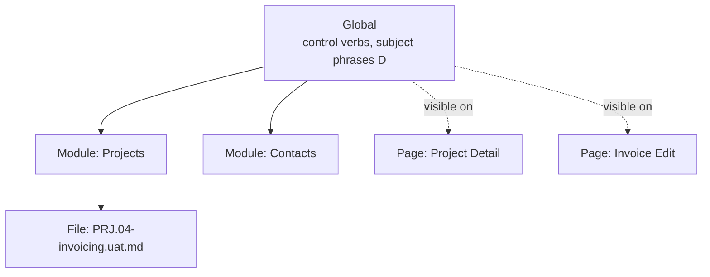

# Phrase scopes

Status: discussion
Date: 2026-09-26
Follows: [splitting-phrases.md](splitting-phrases.md), which this revises

## Why a second doc

The first doc judged the options against the Todo sample. Todo is only an example. The real
target is a very large test set: Construction, with many modules and many testers writing
scenarios. At that size, some verdicts change:

| Option | First verdict | Revised |
| --- | --- | --- |
| A. By page | only through controls | **Yes, as a scope.** Pages can own compound phrases. |
| B. By scenario | no | **Yes, as a scope**, for the file or module that needs domain phrases. |
| C. By keyword | no | No (agreed). |
| D. By subject | yes, for outside-the-app phrases | Yes (agreed). |
| E. Into controls | do this first | Preferred, but **only for generic, small verbs**. |
| F. Scoping (new) | open question | **Yes: pages and scenarios as namespaces for phrases.** |
| G. Callable scenarios (new) | not discussed | Needed. Moved to its own discussion: [callable-phrases.md](../callable-phrases/callable-phrases.md). |

A, B and F are one idea seen from three sides: **a phrase has a scope, and pages and scenarios
are scopes.** That is what this doc is about. G, defining phrases *in scenario language* rather
than in C#, builds on it and is discussed separately.

---

## A. Page phrases: compound actions that belong to a page

A page does more than hold controls. It has workflows that are that page's own:

```gherkin
Given I am on the Todo List page
When I create a todo "Write the report"
```

"create a todo" is Add, set Title, Save, back on the list. It isn't a control verb (it spans
three controls and two pages), and it isn't a generic phrase (it only means something on the list
page). The page object already has it:

```csharp
public TodoListPage CreateTodo(string title) => Add().EnterTitle(title).SaveNew();
```

Making it a phrase is one attribute:

```csharp
[UatStep(UatEffectiveStepKeyword.When, "I create a todo {value}")]
public TodoListPage CreateTodo(string title) => ...
```

**The return type does real work here.** `CreateTodo` returns `TodoListPage`, `Edit()` returns
`TodoEditPage`, `SaveEdit()` returns `TodoDetailPage`. The page objects already declare where each
compound action ends, so the engine can know which page is current after the step without
running it. That is what makes page scoping (F) possible at bind time. See below.

Where page phrases pay off in a large set: the same 4-step "fill the address block" or "add a
line item" appears in dozens of scenarios. On the page, it's written, maintained and fixed once.

Guardrail: a page phrase is still **one user intent**. "I create a todo" is fine. "I create a
todo and open it and mark it done" is three intents, and should be three steps or a callable
scenario (G).

## B. Scenario (and module) phrases: domain language for one area

Some phrases only make sense inside one part of the product:

```gherkin
# Scenarios/Projects/PRJ.04-invoicing.uat.md
Given a project with an unbilled work order of 8 hours
When I invoice the project
Then the invoice should have 1 line for 8 hours
```

"an unbilled work order" means nothing in Contacts or Settings. As a global phrase it pollutes
every scenario writer's vocabulary and competes for text with other modules.

Two granularities:

| Scope | Where it's declared | Use it for |
| --- | --- | --- |
| **Module** (a scenario folder, e.g. `Scenarios/Projects/`) | phrase classes tagged with the module, or a phrase file in the folder | the module's domain language. **This is the main case.** |
| **Single file** | inside the `.uat.md` itself (see G) | a helper one journey needs several times, not worth sharing |

Scoping by module rather than by single scenario is the useful default. A single scenario rarely
needs its own vocabulary; a module always does.

## C. By keyword

Agreed: no. One concept shouldn't be split across three files by grammar.

## D. By subject

Agreed: for phrases that touch the world outside the screen (backend, device, lifecycle, stored
data), group them by what they touch. These are usually **global** (every module arranges the
server the same way), which fits: D is the organisation of the global scope.

## E. Control verbs: preferred, but small and generic

Agreed with the correction: a control verb is the **most reusable** kind of phrase, so it must be
the **least specific**.

| Belongs on a control | Doesn't |
| --- | --- |
| `I tap {control}`, `{control} should equal {value}` | anything naming a domain concept ("invoice", "work order") |
| `I choose {value} in {control}` (dialog) | anything spanning controls (that's a page phrase, A) |
| `{control} should show the {value} state` (state container) | anything needing fixture state (that's a subject phrase, D) |

App-specific but still small controls (`TodoList`, `TodoStatus`) can carry verbs too. The test is
"one control, one action", not "lives in Brinell".

---

## F. Scoping: pages and scenarios as namespaces

### The model

Today the catalog is one flat list. With scoping it becomes nested, like namespaces:



A step can bind to a phrase from:

1. the **current page** (page phrases, A, and control verbs on that page, E);
2. the **current file** (file-local phrases, G);
3. the file's **module** (B);
4. **global** (D, and generic control verbs).

Everything a step can see is the union of these. **No shadowing:** if a step matches phrases in
two visible scopes, that's an ambiguity error at bind time, not "innermost wins". Shadowing is
what makes namespaces confusing in code. In prose that a tester reads, the same sentence must
never mean two things in one place.

What scoping buys, for a large set:

- **Collisions stop being global.** "I add a line" can mean one thing on Invoice Edit and
  another on Purchase Order Edit. The two scopes never overlap, so there is no ambiguity.
- **Discoverability.** Tooling (the Presenter, an editor completion list) can offer only the
  phrases visible *here*, which is a short list, instead of all of them.
- **Ownership.** A module team owns its module scope and can change it without checking every
  other module's scenarios.

### The hard part: knowing the current page at bind time

Binding happens before execution (`UatBinder.Bind` binds the whole document). So "the current
page" has to be known **statically**, by reading the steps in order:

| Step | Page after it |
| --- | --- |
| `Given I am on the X page` | X |
| `Then I should be on the X page` | X |
| a page phrase whose method returns a page type (`CreateTodo` returns `TodoListPage`) | that page |
| a call to a callable phrase ([G](#g-callable-scenarios)) | the page its inner steps end on, tracked through them in the caller's page; unchanged if they name none |
| a control verb (`I tap Save`) | **unknown**, unless the control declares it |

This table is the one definition of "the page after a step". Callable phrases add no rule of their
own: their inner steps are bound in order, in the caller's page, so the page after the call falls
out of the rows above. The callables doc only adds checks that need no tracking (a callable that
names a page must end on one; a per-row body ends where it started).

The last row is the gap. `I tap Save` might go anywhere. Three ways to handle it, and they
combine:

1. **Unknown means the page must be re-stated.** After a step that leaves the page unknown, the
   next page-scoped step needs an `I should be on ...` first. The scenarios already do this (TOD
   files assert the page after every navigation), so it costs little and reads well.
2. **Navigation metadata on buttons.** `[UatNavigatesTo(typeof(TodoListPage))]` on `SaveButton`
   when it always goes one place.
3. **Fall back to run-time binding** for the step. This loses the early "unbound step" error for
   that step, so it should be the exception.

Recommendation: 1 as the rule, 2 where it's free. 3 only if it proves necessary.

### How a phrase declares its scope

| Kind | Scope comes from |
| --- | --- |
| Control verb | the page the control is on (already true today) |
| Page phrase | the page object it's declared on (A) |
| Module phrase | `[UatPhraseClass(Module = "Projects")]`, matched against the scenario folder or the `Area` metadata |
| File phrase | its position inside the `.uat.md` (G) |
| Global | no scope, which is today's default |

Namespaces are then the **natural structure** of the code: page phrases live on page objects,
module phrases in `Phrases/Projects/`, global ones in `Phrases/` grouped by subject (D). Scope
and file layout line up, which answers the original question ("how to split the large file").

---

## G. Callable scenarios

Named, parameterised step sequences that testers write in scenario language, with a hard line
against control flow. They have their own discussion:
[callable-phrases.md](../callable-phrases/callable-phrases.md). They fit the scope model above:
declared in a file, a module or globally, and visible there. The page after a call is defined in
[the page table above](#the-hard-part-knowing-the-current-page-at-bind-time).

---

## How it fits together

| Layer | Written by | Written in | Scope |
| --- | --- | --- | --- |
| Control verbs (E) | framework / app devs | C#, `[UatStep]` on controls | the page the control is on |
| Page phrases (A) | app test devs | C#, `[UatStep]` on page-object methods | that page |
| Subject phrases (D) | app test devs | C#, phrase classes by subject | global |
| Module phrases (B) | app test devs | C#, `[UatPhraseClass(Module = ...)]` | a module |
| Callable phrases (G, [separate](../callable-phrases/callable-phrases.md)) | **testers** | markdown, `## Phrase:` | file, module or global |

The top four need a developer and can contain logic. Callable phrases need no developer and can't.

## Proposed order

1. **Page phrases (A):** `[UatStep]` on page-object methods, and the returned page type recorded
   as "page after". This is small and uses what the page objects already declare.
2. **Static page tracking in the binder (F, rule 1):** page-scoped binding for control verbs and
   page phrases, ambiguity errors across scopes.
3. **Module scope (B):** `Module` on `[UatPhraseClass]`, matched to the scenario folder.

Each step is useful on its own, and none needs the next one.

Callable phrases (G) do not wait for this order. Their file-local and global parts need no scope
and are built first. They are expanded inside the binder's walk over the steps, so when static
page tracking (2) lands it follows the page through their inner steps with no rework. Module
phrase files wait for module scope (3). The combined order:

| # | Work | Doc |
| --- | --- | --- |
| 1 | Callable phrases: file-local, types, tables, per-row, guardrails, global `*.phrases.md` | [callable-phrases.md](../callable-phrases/callable-phrases.md) steps 1-5, 7 |
| 2 | Page phrases (A) | this doc, step 1 |
| 3 | Static page tracking (F), with callables as a source of the page after a step | this doc, step 2; callables step 8 |
| 4 | Module scope (B), then module `*.phrases.md` files | this doc, step 3; callables step 6 |

## Open questions

| Question | Notes |
| --- | --- |
| Module = folder, or module = `Area` metadata? | Folder is visible and needs no extra field. `Area` survives moving files. Folder is probably simpler. |
| Can a module phrase be used on any page, or only on the module's pages? | Module scope and page scope are independent axes. Start with "any page". |
| How does the Presenter show scopes? | A catalog view grouped by scope, and step completion filtered to what's visible at the cursor. |
