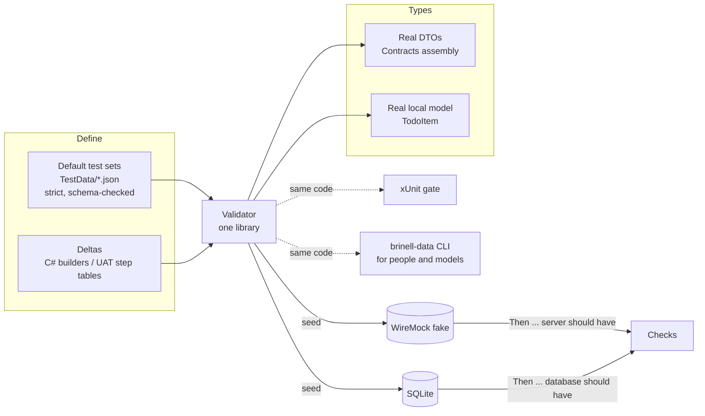

# Proposal: test data - defining, seeding and checking it

Status: implemented (see [AD-012](../../.docs/decisions/ad-012-test-data-is-typed-validated-and-chosen-by-the-scenario.md) and [Test Data](../../docs/guides/test-data.md))
Date: 2026-09-24
Target: `samples/Todo` first, then Construction
Related:

- [TodoTestSet.cs](../../samples/Todo/tests/Brinell.Samples.Todo.TestSupport/TodoTestSet.cs) - the named test sets (was TodoScenario.cs)
- [TodoServerStub.cs](../../samples/Todo/tests/Brinell.Samples.Todo.TestSupport/TodoServerStub.cs) - today's stateful WireMock fake
- [complex/02-service-validations.md](complex/02-service-validations.md) - checking requests the app sent
- [complex/03-database-checks.md](complex/03-database-checks.md) - checking what the app stored
- [tod-02-single-journey-uat.md](tod-02-single-journey-uat.md) - one UAT file per journey

---

## 1. Problem

Most tests need starting data before the first tap:

| Part | Todo today | Construction |
| --- | --- | --- |
| What the **server** has | WireMock, `TodoServerStub` | WireMock stubs per endpoint |
| What the **device** has | SQLite, seeded before launch | SQLite / local cache |
| **Time** | `Now` pinned (`TODO_NOW`) | - |
| **Network** | `NetworkStateFile` | `NetworkStateOverride` |

The questions:

1. Where is the data defined: in separate files or in code?
2. How do we make sure WireMock serves the **real DTO classes** and not anonymous objects?
3. How can a person or a model (LLM) find out that the data is wrong **before** a UI run fails
   for a reason that has nothing to do with the test?
4. How do we check the data **after** the test (service and database validations) with the same
   definitions?

## 2. What exists today (Todo)

The Todo sample already does a lot of this right:

- `Scenarios/*.json` are **named default test sets** (`three-todos`, `empty`, `overdue`,
  `pending-local-change`), each with `now`, `server` and `local`. The integration tier and the UI
  tier load the same file, so "three-todos" means the same thing everywhere.
- `server` is deserialized into the real `TodoDto` (`Brinell.Samples.Todo.Contracts`).
- The local half is written through the app's own migrations and repository, so the schema is
  always valid.
- `TodoServerStub` is a **stateful fake** built on `TodoDto`: a pushed todo shows up in the next
  pull, and tests read `Server.Todos` to see what the app sent.
- The contract tests keep the fake honest against the real `Todo.Api`.

Weak spots:

| # | Weak spot | Example |
| --- | --- | --- |
| W1 | Deserialization is **lenient** (`TodoScenario.JsonOptions` does not disallow unknown fields) | `"titel": "Buy milk"` loads without an error; the todo gets a `null` title, and a UI test fails far from the real cause |
| W2 | The local half uses a **private copy** (`LocalTodo`) of the model, not a real type | A new field on `TodoItem` does not cause a compile error |
| W3 | No rules across records | Duplicate ids, `UpdatedAt < CreatedAt`, a local "Synced" todo that the server does not have |
| W4 | `MockApiServer.ReturnsJson(object)` accepts anything | `ReturnsJson(new { titel = "x" })` compiles and serves a body the app cannot read |
| W5 | Per-test variations are written only in C# | A UAT scenario cannot say "the server also has this todo" |
| W6 | Only the server half can be changed after launch | The local half is seeded before launch. Changing it needs a restart (and on Android it is never seeded at all) |

## 3. Proposal in one picture



There are three layers: **default test sets** in files, **deltas** per test, and **checks** after
the test. They all use the same types and one validator.

## 4. Where the data lives

### 4.1 Default test sets: files (keep and harden)

Keep named JSON default test sets. They are the part that non-developers and models read and edit, and they
are shared by every tier. Changes:

- **Strict loading.** Set `UnmappedMemberHandling = Disallow` and require the properties that are
  not nullable. This is the same setting `ContractTests` already uses. It fixes W1.
- **Real types on both halves.** `server` is `TodoDto[]`. `local` becomes the app's own type, or a
  public test DTO that maps to it in one place in the app's own code (`TodoMapping`). It must not be
  a private mirror. This fixes W2.
- **JSON Schema generated from the DTOs** (`JsonSchemaExporter`, .NET 9+) and referenced from each
  file (`"$schema": "../testdata.schema.json"`). Editors then show errors and autocomplete fields.
- **Rename `Scenarios/` to `TestData/`** (decided). "Scenario" already means a Gherkin scenario in
  the UAT project, and one word should not mean two things.

```jsonc
// TestData/three-todos.json
{
  "$schema": "../testdata.schema.json",
  "now": "2026-03-10T09:00:00Z",
  "server": [
    { "id": "11111111-0000-0000-0000-000000000001", "title": "Buy milk", "status": "Open",
      "dueDate": "2026-03-12", "createdAt": "2026-03-01T08:00:00Z", "updatedAt": "2026-03-01T08:00:00Z" }
  ],
  "local": [
    { "id": "11111111-0000-0000-0000-000000000001", "syncState": "Synced" }   // see 4.2 "sameAsServer"
  ]
}
```

Optional shortcut: a local entry with only `id` + `syncState` copies the server record with the same
id. Most default test sets are "synced copies", and this removes the duplication that makes `three-todos.json`
hard to read. The validator reports an id that has no server record.

### 4.2 Deltas per test: code builders, and step tables in UAT

A test changes one thing on top of a baseline. Two front ends feed **one builder**:

**C# (unit, integration, UI tests)** - a builder that returns the real DTO, with defaults that fit
the test set (`Now`, deterministic ids):

```csharp
var todo = TodoData.Todo("Call plumber").Due(-1).InProgress().Build();   // TodoDto
_fixture.Server.Store(todo);
```

**UAT** - a custom phrase with a step table. The table is bound to the **same builder**. Its
columns are the DTO's property names, and an unknown column is an error, not a column that gets
ignored:

```gherkin
Given the server also has todos
  | Title        | Status     | Due   |
  | Call plumber | InProgress | -1d   |
And the app has synced
```

- Only the columns that matter are listed. The builder fills in the rest.
- Relative dates (`-1d`, `today`) are resolved against the test set's `now`. Scenarios stay
  readable, and they give the same result on every run.
- The table binder is **generic** (`UatTable -> T` through the record constructor). It belongs in
  `Brinell.Uat` once, not in each app.

This fixes W5.

### 4.3 Why not only code, or only files

| Option | Readable by PO/QA/model | Checked at compile time | Shared by tiers | Verdict |
| --- | --- | --- | --- | --- |
| Only C# builders | no | yes | yes | Good for developers, but UAT cannot use it |
| Only JSON files | yes | no (fixed by schema + validator) | yes | Too heavy for "one extra todo" |
| Inline tables only | yes | no | UAT only | Fine for deltas, too flat for whole test sets |
| **Files for baselines, builders + tables for deltas** | yes | yes (with the validator) | yes | **Recommended** |

## 5. WireMock with real DTOs only

Rule: **a stubbed response body is a real contract type**, or a recorded sample file from the
real API. It is never an anonymous object.

1. **Prefer a typed fake per API** (like `TodoServerStub`): it owns the routes and takes and returns
   DTOs. Tests call `Server.Store(TodoDto)`, not `mock.Get(...).ReturnsJson(...)`.
2. **Typed overloads in `Brinell.Mocking`**: add `ReturnsJson<TDto>(TDto body)` and
   `MockResponse.Json<TDto>(...)`, and mark the `object` overload `[EditorBrowsable(Never)]`.
3. **Analyzer** (`BRINELL0xx`, warning in test projects): an anonymous type passed to `ReturnsJson`
   / `MockResponse.Json` / `RespondsWith` bodies. Generics alone cannot block anonymous types,
   because `T` can be an anonymous type too, so the analyzer is the real guard. It fixes W4.
   `MockApiServerTests` (the framework's own tests) keeps using anonymous bodies under a
   suppression, because it tests the server and not a contract.
4. **Errors and odd bodies** (500, empty, malformed JSON) go through `Fails(...)` / `ReturnsText`
   and are written to look deliberate.
5. **Contract tests stay the honesty check**: the same request to the fake and to the real API
   must give the same answer.

For Construction: the DTOs must be reachable from the test project. If they are `internal` in the
app assembly, add `InternalsVisibleTo` or move them to a contracts assembly, as Todo does. Do
**not** copy them into the tests.

## 6. Seeding

| Half | How | Why |
| --- | --- | --- |
| Server | Load into the typed fake (`Install(mock, defaults.Server)`) | Stateful, resettable per test |
| Local, normal | The app's migrations + repository (as today) | The schema is always valid, and there is no second SQL dialect to maintain |
| Local, broken or legacy | Raw SQL script next to the test set (`TestData/schema-v1.sql`) | Migration tests (TOD.09.2) need states that the current repository cannot write |
| Local on Android | Seed the server and let the first sync pull it, or push the file with `adb` before launch | The device cannot open files on this machine (W6) |

**Changing the test data between scenarios.** The server half can be reset per scenario (the typed
fake is reset in `StartTest`). The local half is fixed at launch. So:

- A UAT **file** names its default test set in its metadata (`TestData | one-todo`). The fixture
  reads it from there instead of hard-coding it; see 6.1.
- A C# test class picks it through its fixture, as today (`ThreeTodosFixture`, `EmptyFixture`).
- A scenario that needs a different local state writes it through the UI or through the server +
  sync. It does not reseed the database under a running app.

### 6.1 The UAT file chooses the test set, not the fixture

Today `TodoUatFixture` hard-codes `ScenarioName => "three-todos"`, and every UAT file runs against
it. Proposal: the fixture only knows **how** to load a test set. **Which** one comes from the
`.uat.md` file:

```markdown
| Field | Value |
| --- | --- |
| Journey | TOD.02 |
| TestData | one-todo |
```

How it works:

1. `uat.config.md` names a default for files that do not say (`DefaultTestData | three-todos`).
2. Before the first scenario of a file, the runner calls `fixture.UseTestData(name)` (a new hook
   next to `BeforeScenario`).
3. If the app is already running on that test set, nothing happens, and the usual per-scenario
   `StartTest` reset follows.
4. If the test set is different, the fixture closes the app, seeds a fresh database from the new
   set, resets the typed fake to its server half, and starts the app again with that set's `now`.
5. `GetScenarioFiles` sorts the files by test set, so a run restarts the app once per **distinct**
   test set, not once per file.

What this needs in the fixture: today the app is launched in the fixture's constructor with launch
settings fixed at that moment. `UseTestData` needs a **restart with new launch settings** (a new
`FixedNow`, and possibly a new database path). `RestartApp()` exists but reuses the old settings,
so the base fixture needs an overload that takes new ones. That is a change in
`TodoAppFixtureBase`, not in Brinell.

The validator checks the reference too: a `TestData` value that names no file in `TestData/` is an
error before any run (section 8, rule 4).

## 7. Checks after the test: service and database validations

Checks use the **same types and the same table binder** as the setup, so Given and Then look the
same:

```gherkin
When I set Title to "Call plumber"
And I tap Save
Then I should see "Call plumber"                     # UI sentinel first (complex/03, rule 1)
And the database should have todos
  | Title        | SyncState |
  | Call plumber | LocalOnly |
When I tap Sync
Then a PUT to "/api/todos/*" should have been sent   # complex/02, rule 1
And the server should have todos
  | Title        | Status |
  | Call plumber | Open   |
```

- **Partial match.** Only the listed columns are compared. Unlisted fields are not checked, so a
  check does not break when an unrelated field changes.
- **Server checks** read the typed fake's state (`Server.Todos`) or `WaitForRequest(...).BodyAs<TDto>()`.
  They never read a raw JSON string.
- **Database checks** use a read-only connection to the app's `DatabasePath`, as in
  [complex/03](complex/03-database-checks.md). They read into the **same local model type** that
  seeding uses, and do not go through the app's repository, so a repository bug cannot make its own
  check pass.
- **Failure output** shows the expected table, the actual rows, and the differing cells. This is
  the part that makes a failed check quick to act on.

`complex/02` and `complex/03` already describe the phrases. This proposal adds that they share
types and the table binder with the setup.

## 8. A CLI so people and models can check the data

**Yes, but as a thin front end over the validator that the xUnit gate also runs.** It is not a
separate source of truth.

One generic tool, **`Brinell.DataValidator`** (`srcnew/`, packed as a `dotnet tool`,
command `brinell-data`). It knows nothing about Todo. It **loads the app's test-support assembly
at run time** and finds the definitions there:

```powershell
# from samples/Todo/tests/Brinell.Samples.Todo.Uat
brinell-data validate
brinell-data validate TestData/overdue.json --format json
brinell-data describe TodoDto
brinell-data list
brinell-data schema
```

**Finding the assemblies.** The tool reads the `## Assemblies` table of the `uat.config.md` in the
current folder. That table already lists `Pages`, `Controls` and `Commands`, and gets one more row:

```markdown
| Kind | Assembly |
| --- | --- |
| TestData | ../Brinell.Samples.Todo.TestSupport/bin/Debug/net10.0/Brinell.Samples.Todo.TestSupport.dll |
```

`--assembly <path>` overrides it, for apps that have no UAT project.

**Loading.**

- Each assembly is loaded into its own `AssemblyLoadContext` with an `AssemblyDependencyResolver`
  on its `.deps.json`, so the app's own dependencies (SQLite, its Contracts assembly) resolve from
  its `bin` folder, not from the tool's.
- The small abstractions assembly (`Brinell.TestData`: `ITestDataDefinition`, rule attributes) is
  **shared** from the tool's context. If it were loaded twice, the tool's `ITestDataDefinition` and
  the app's would be different types, and nothing would be found.
- The tool finds every public, non-abstract `ITestDataDefinition` in the assembly. The definition
  says where the test-set folder is, which root type a file is read into (`TodoTestSet`: `Now`,
  `Server: TodoDto[]`, `Local: TodoItem[]`), and which app rules to run.
- The tool works on the **built** assembly. If the DLL is older than the source files of its
  project, it prints a warning ("rebuild first"). Otherwise a model that has just changed a DTO
  would validate against the old one.
- Target: the tool is `net10.0`. A test-support assembly that targets `net10.0-windows` or a MAUI
  platform cannot be loaded. The data definitions belong in an assembly without a platform or MAUI
  dependency, which is where Todo's `TestSupport` already sits.

| Command | What it does |
| --- | --- |
| `validate` | Loads every test set strictly and runs the rules (below). Prints `file:line: code message`, with `--format json` for a model. Exit code 0 or 1. |
| `describe <Type>` | Fields, types, which are required, enum values. A model reads this instead of guessing the DTO. |
| `list` | Default test sets, what each contains, which fixtures and `.uat.md` files use it |
| `schema` | Regenerates `testdata.schema.json` from the DTOs |

Validation rules, in order:

1. **Shape** - strict deserialization into the real types (unknown field, missing required field,
   wrong enum).
2. **App rules** - run the app's own validation (`TodoValidation`: title required, at most 100
   characters) on every record, so the seed data cannot be something the app would refuse.
3. **Consistency** - unique ids, `CreatedAt <= UpdatedAt`, every local `Synced` record exists on the
   server with the same values, `now` is set.
4. **References** - every test set named by a fixture, a `TestData` metadata field or a UAT step table
   exists, and every step-table column is a property of the target type.

Why a CLI and not only the test: an agent that edits `TestData/*.json` or a `.uat.md` table can run
`validate` in about a second and read structured errors. Otherwise it only learns about the mistake
from a 3-minute UI run that fails somewhere else.

**The gate uses the same engine.** The validation engine (`TestDataValidator`) lives in
`Brinell.TestData`, not in the tool. The xUnit test (`TestDataTests`) references it and the app's
TestSupport directly, with no run-time loading. The tool is only the host around the engine:
loading, arguments and output format. CI and the tool therefore cannot give different answers.

| Assembly | Contains | Used by |
| --- | --- | --- |
| `Brinell.TestData` | `ITestDataDefinition`, `TestDataValidator`, strict loader, schema export, table-column checks | the app's TestSupport, the gate, the tool |
| `Brinell.DataValidator` | CLI host: config reading, `AssemblyLoadContext`, commands, output | people and models |
| `Brinell.Samples.Todo.TestSupport` | `TodoTestDataDefinition`, `TodoTestSet`, `TestData/*.json`, the rules | the Todo test projects, loaded by the tool |

## 9. Rollout

1. **Strict loading + consistency rules** in `TodoScenario`, plus a `TestDataTests` gate (W1, W3).
   Small, and it pays off straight away.
2. Replace `LocalTodo` with a real type, and add the "same as server" shortcut (W2).
3. `ReturnsJson<TDto>` overloads + the anonymous-body analyzer in `Brinell.Mocking` (W4).
4. The `TodoData` builder, and the generic `UatTable -> T` binder in `Brinell.Uat`, with
   `Given the server also has ...` and `Then the server/database should have ...` phrases (W5, section 7).
5. `Brinell.TestData` (engine) + `Brinell.DataValidator` (tool, run-time loading), plus
   `TodoTestDataDefinition` in TestSupport. Generate `testdata.schema.json`.
6. Rename `Scenarios/` -> `TestData/` in TestSupport.
7. `TestData` metadata in `.uat.md` + `UseTestData` in the UAT fixture, instead of a hard-coded name
   (6.1).
8. Construction: move or expose the DTOs, add its `ITestDataDefinition`, and point the same tool at
   it.

## 10. Decisions (2026-09-24)

| # | Question | Decision | Follow-up it implies |
| --- | --- | --- | --- |
| D1 | Folder name | `TestData/` | Rollout step 6 |
| D2 | Format | **JSON for now.** Other formats may come later. | Keep format-specific code in one loader (`ITestDataLoader`), so YAML or another format can be added without touching the validator or the seeders |
| D3 | Size | Brinell has to work from tiny apps (Todo) to huge ones (thousands of tables) | See 10.1 |
| D4 | Live tier | Seed through the app's **live API when it has one**. If it does not, **read and write the database directly**. | See 10.2 |
| D5 | Which test set a test uses | Depends on the app and the tests. One or more **default test sets** per app, and tests **add and remove** records on top of them | See 10.3 |
| D6 | Naming | "Default test set" / "test set", not "world". `TestDataValidator`, `ITestDataDefinition`, `testdata.schema.json` | - |
| D7 | The CLI | One generic `Brinell.DataValidator` that loads the app's assemblies at run time, not a tool per app | Section 8 |
| D8 | Who chooses the test set | The `.uat.md` file (`TestData` metadata), not a name hard-coded in the fixture | 6.1 |

### 10.1 Scaling to large apps (D3)

Hand-written JSON does not scale to thousands of tables. What changes as apps grow:

- **Split a test set per module or table group**, and let a test set **compose** others
  (`"include": ["base/company.json", "projects/small.json"]`). The validator then checks
  references between files (foreign keys), not only inside one file.
- **Builders generate bulk data** (`ProjectData.Many(500)`), with deterministic ids and a fixed
  seed. Files keep the small number of records that tests refer to by name.
- **Seed once, copy per run.** Build the database from the default test set once (migrations +
  inserts), keep the file or a DB backup as a cached artifact keyed on the hash of the test-set files
  and the schema version, and copy it for every fixture. Inserting thousands of rows at every
  launch is too slow.
- **Server data is served, not preloaded.** For large APIs the typed fake answers from the test
  set on demand (paging, filtering) instead of registering one stub per record.
- **The validator must stay fast**: it validates only the files that changed, and rules are declared
  per table/DTO, so an app with 1,000 tables does not need 1,000 hand-written checks.

### 10.2 Live tier (D4)

| Route | When | Risks and rules |
| --- | --- | --- |
| Live API (`LiveTodoApi`) | The app has one | Goes through the business rules; slower. Preferred. |
| Direct database write | No API, or the API cannot create the state (legacy, broken) | **Skips the backend's business rules**, so the validator's app rules (step 2 in section 8) are the only protection. Needs the DB schema as types, and a connection string from settings, never from a test. |

In both routes the live backend **cannot be reset** like WireMock. So:

- Every run creates **its own records**, with a run id in a name or tag (`[run-7f3a] Buy milk`),
  and tests find their records only by that id.
- Clean up at the end of the run, and also sweep up leftovers from older runs, because a crashed run
  leaves records behind.
- Checks against a live backend are always **partial matches on the run's own records**, never
  "the server has exactly these todos".

The same test-set files are used; only the seeder behind them changes (`ITestDataSeeder`:
WireMock, SQLite file, live API, live DB).

### 10.3 Default test sets, tests add and remove (D5)

This fits the current Todo convention ("tests work on todos of their own"), with one rule:

- **Adding** on top of a default set is always safe.
- **Changing or removing** a default record is safe only for the part that is **reset per test**.
  Today that is the server half (the fake is reset in `StartTest`). The local database is not reset,
  so a test that deletes a default todo on the device breaks later tests in the same collection.
  Such a test either adds its own record first and removes that one, or it runs in a fixture of its
  own.
- If removing default records becomes common, add a per-test reset of the local half as well
  (restore the cached DB copy from 10.1 and restart the app). That costs a restart per test, so
  it should be opt-in per fixture.
- A UAT file chooses its default set in its metadata (`TestData | one-todo`), and the fixture
  loads it (6.1). A C# test class chooses it through its fixture.
