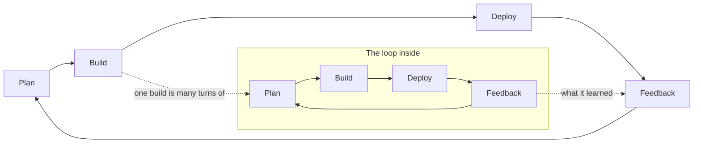

# Loops in loops: the dark factory we build with

Our SDLC is a small AI software factory: agents write, test and review the code, while the owner
designs the factory and steers it. This note explains it as loops. Every loop turns the same four
phases: plan, build, deploy, feedback. The loops sit inside each other, two of them run across all
the others like the Olympic rings, and above the whole thing the management loop, the SDLC itself,
looks at the factory. It covers how Tomorrow (TWBB, the game) uses it, and how
the Migrator uses the same idea.

## What a dark factory is

A dark factory runs with the lights off: nobody stands at the line, because the line checks
itself. People design the line, set its standards and look at what comes out. The hardest part
is not the building but the controls: the tests, reviews and checks that let a loop trust its
own output.

## One loop: plan, build, deploy, feedback

Every loop goes round the same circle. It plans what to make, builds it, deploys it where it can
be used, and takes the feedback into the next plan. Only the size changes.

We size the loops in **AI time**: AI minutes, AI days, AI weeks. An AI day is the work a person
would call a day's work, but an agent gets through it in an hour or a night. A capability that
is a few AI days is built while the owner sleeps; a module of AI weeks takes days on the clock.
The loops that need a person, playing, the specs, the management loop, still run in human time.
So the factory's speed is set less by how fast agents build than by how fast people give
feedback.

A loop is **dark** when it goes round without a person. That needs an exact test at the feedback
phase, and a record that lets the next turn start cold. The small loops go dark first, because
their feedback is cheap and exact. The large loops stay lit longer, because their feedback is
judgement: is this fun, is this the right next thing, does the architecture still hold.

## Loops in loops

The build phase of every loop is a whole turn of the loop inside it. Building a capability is
turning its tasks; building a module is turning its capabilities. So each inner loop goes round
many times while its outer loop goes round once.

| Loop | Plan | Build |
| --- | --- | --- |
| Task (AI minutes) | Write the test first | The smallest code that passes |
| Capability (AI days) | Brief and design | Its tasks |
| Module (AI weeks) | Overview and register | Its capabilities |
| Architecture (AI months) | Decisions and catalog | Its modules |

| Loop | Deploy | Feedback |
| --- | --- | --- |
| Task | Commit on green | Every test green, then refactor |
| Capability | Pushed to `game`, the play copy | Review, then the owner plays it |
| Module | Hosted at `twbb.eu` | The register of follow-ups |
| Architecture | The shape all code follows | The checkpoint finds the drift |

### Task loop

Plan is the test, build is the code, deploy is a green commit, feedback is the suite. The
feedback is exact, so this loop runs fully dark. In Tomorrow it is Loop 2 under `/step-build`.
In the Migrator it is one bounded slice for the Focused Migration Implementer, checked by focused
tests.

### Capability loop

One outcome a person can use: brief and design, then the task list, then pushed, then reviewed and
played. This is the loop we made dark on purpose: delegated gates, the architect agent reading the
design and the diff cold, and must-fixes going back to build. Only "play" still needs the owner, so
an unattended run ends a capability as "built, awaiting play". In the Migrator the same loop is the
Capability plan's six stages: understand and design (plan), build, validate and accept (feedback),
learn (into the next plan).

### Module loop

A feature area that grows one capability at a time: world, quests, fight. Its plan is the module
overview and its follow-up register, which every brief reads first. In Tomorrow this loop is thin:
modules grow, they rarely close. In the Migrator it is the strongest loop, with eight stages from
open to close. Its Empty Framework, a page skeleton built before any behaviour, is the module's
plan made concrete before the capabilities fill it.

### Architecture loop

The plan is the decisions in `.doc/` and the architecture catalog; the build is everything the
modules add; feedback is a checkpoint every third step, where the architect reviews the whole
codebase for drift. In the Migrator the Target Architect and the Architecture Catalog play that
role. Both keep one rule: a night run may reuse an approved architecture choice, but never make a
new one. This loop stays lit.

## The rings that run across

Two loops don't nest. They join the same phase of every level, and turn at their own pace.

**The specs loop** joins the plan phases. In Tomorrow it is `.designs/`, worked out with the owner
in conversation, outside any step; it feeds the plan, a brief and a task's test, and a play can
change it. In the Migrator the spec is the old Android app: the Source Analyst and Contract Analyst
turn it into evidence, and nothing is built that the source does not show.

**The deployment loop** joins the deploy and feedback phases. In Tomorrow every step pushes to
`game`, the owner plays from a separate play copy while the factory keeps building, and `twbb.eu`
brings in testers. What they find comes back as tasks, register entries or design changes. In the
Migrator this loop is thinner: the app is launched for runtime evidence and modules get videos, but
the release stays the team's.

The two rings cross each other and every nested loop, like the Olympic rings. That is why a loop's
state lives in files, never in a chat: each crossing point is a file, such as a brief, a design, a
register entry or a review's "how to play".

## Above it all: the management loop

One loop doesn't build the game at all. The management loop, the SDLC loop, looks at the whole
factory: the nested loops, the two rings and the owner in them. Its product is the way of working.

- **Plan:** `sdlc.md` and the writing rules: the phases, the gates, what may run unattended.
- **Build:** the skills, agents, templates, `Test-Sdlc.ps1` and the permissions allowlist.
- **Deploy:** a new version of the method, pinned into each run's `900-status.json`.
- **Feedback:** the SDLC review every twenty steps reads the status files, run logs, rework and
  record sizes: where runs stopped, which gates waited for the owner, what grew without being read.

In the Migrator the same loop is the plans and templates under `.migration/`, the calibration runs,
`Measure-MigrationRun.ps1` telemetry and the pinned `agentVersion` and `planVersion`. It is the one
loop that is never dark. This is where the owner works most: not on the game, but on the line.

## Tomorrow and the Migrator side by side

| Loop | Tomorrow (TWBB) | Migrator |
| --- | --- | --- |
| Task | `/step-build`, test first | Focused Implementer slice |
| Capability | `/step`, brief to close | Capability plan, 6 stages |
| Module | Overview and register | Module plan, 8 stages; Empty Framework |
| Architecture | Checkpoint every third step | Target Architect, catalog |
| Management (SDLC) | SDLC review every 20 steps | Calibration, telemetry |
| Specs loop | `.designs/` with the owner | Android source and contracts |
| Deployment loop | Play copy, `twbb.eu` | Local launch, module videos |

Both have one orchestrator in the main conversation that turns the loops, specialists that return
evidence, and gates with three outcomes: pass, pass with follow-ups, stop.

## Where the light stays on

The factory got faster each time a feedback phase moved from "the owner approves" to "the test
decides": the delegated brief, the architect as the design gate, only the tiers a step touches.
The light stays on where the feedback is taste or direction: playing the game, choosing the next
item, a new architecture choice, anything that spends money or deletes data. That is not a gap in
the factory; it is the owner's job in it.

## Open questions

- Should Tomorrow's module loop get a real close, like the Migrator's? Proposal: no, game modules
  keep growing; let the architecture checkpoint do the module tidy-up.
- Is the deployment loop fast enough? Proposal: measure the days from "built, awaiting play" to
  played, at the next SDLC review.
- Can the specs loop run partly dark? Proposal: not for the game's direction; maybe for the
  Migrator, where the spec is an existing app.
