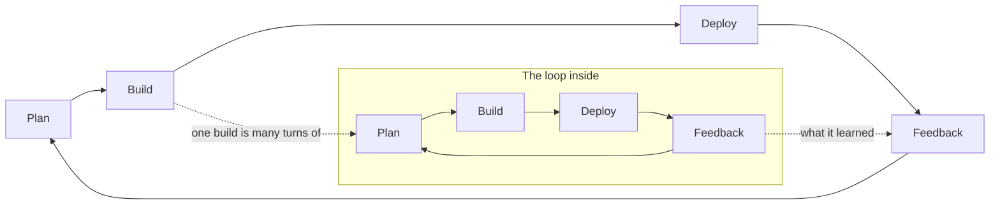

# Loops in loops: building software in a dark factory

In an AI software factory, agents write, test and review the code, while people design the
factory and steer it. This note explains it as loops. Every loop turns the same four phases:
plan, build, deploy, feedback. The loops sit inside each other, two of them run across all
the others like the Olympic rings, and above the whole thing one management loop looks at the
factory itself.

## What a dark factory is

A dark factory runs with the lights off: nobody stands at the line, because the line checks
itself. People design the line, set its standards and look at what comes out. The hardest part
is not the building but the controls: the tests, reviews and checks that let a loop trust its
own output.

## One loop: plan, build, deploy, feedback

Every loop goes round the same circle. It plans what to make, builds it, deploys it where it can
be used, and takes the feedback into the next plan. Only the size changes.

We size the loops in **AI time**: AI minutes, AI days, AI weeks. An AI day is the work a person
would call a day's work, but an agent gets through it in an hour or a night. A capability of a
few AI days is built overnight; a module of AI weeks takes days on the clock. The loops that need
a person, acceptance, the specs, the management loop, still run in human time. So the factory's
speed is set less by how fast agents build than by how fast people give feedback.

A loop is **dark** when it goes round without a person. That needs an exact test at the feedback
phase, and a record that lets the next turn start cold. The small loops go dark first, because
their feedback is cheap and exact. The large loops stay lit longer, because their feedback is
judgement: is this useful, is this the right next thing, does the shape still hold.

## Loops in loops

The build phase of every loop is a whole turn of the loop inside it. Building a capability is
turning its tasks; building a module is turning its capabilities. So each inner loop goes round
many times while its outer loop goes round once.

| Loop | Plan | Build |
| --- | --- | --- |
| Task (AI minutes) | Write the test first | The smallest code that passes |
| Capability (AI days) | Brief and design | Its tasks |
| Module (AI weeks) | Scope and register | Its capabilities |
| Architecture (AI months) | Decisions and catalog | Its modules |

| Loop | Deploy | Feedback |
| --- | --- | --- |
| Task | Commit on green | Every test green, then refactor |
| Capability | Pushed, ready to try | Review, then acceptance by a person |
| Module | Released to its users | The register of follow-ups |
| Architecture | The shape all code follows | A checkpoint finds the drift |

### Task loop

Plan is the test, build is the code, deploy is a green commit, feedback is the suite. The
feedback is exact, so this loop runs fully dark. An agent works one bounded slice at a time and
never leaves the build red.

### Capability loop

One outcome a person can use. The plan is a brief and a design; the build is the task list;
deploy pushes it where people can try it; feedback is a review and acceptance. This is the loop to
make dark first on purpose: delegated gates, a reviewer agent that reads the design and the diff
cold, and findings that send the work back to build. What stays with a person is acceptance:
"yes, this is what I meant".

### Module loop

A feature area that grows one capability at a time. Its plan is its scope and its register of
follow-ups, which every new brief reads first. A module may keep growing, or open and close like a
project. Building an empty skeleton first, with pages and navigation but no behaviour, is the
module's plan made concrete before the capabilities fill it.

### Architecture loop

The plan is the recorded decisions; the build is everything the modules add; feedback is a
checkpoint every few capabilities that reviews the whole codebase for drift. One rule matters most:
an unattended run may reuse an approved architecture choice, but never make a new one. This loop
stays lit.

## The rings that run across

Two loops don't nest. They join the same phase of every level, and turn at their own pace.

**The specs loop** joins the plan phases. Intent is worked out with people, outside any single
loop, and feeds a module's scope, a capability's brief and a task's test. Feedback from any level
can change the spec, and a changed spec can reach into a capability mid-build.

**The deployment loop** joins the deploy and feedback phases. Each capability is pushed when it
stands; people use a copy while the factory keeps building; a release brings in more users. What
they find comes back as tasks, as follow-ups in a register, or as a change to the spec.

The two rings cross each other and every nested loop, like the Olympic rings. That is why a loop's
state must live in files, never in a chat: each crossing point is a file, such as a brief, a
design, a register entry or a "how to try this".

## Above it all: the management loop

One loop doesn't build the product at all. The management loop, the SDLC loop, looks at the whole
factory: the nested loops, the two rings and the people in them. Its product is the way of working.

- **Plan:** the method itself, written down: the phases, the gates, the rules for what may run
  unattended.
- **Build:** the skills, agents, templates, checks and permissions that carry the method.
- **Deploy:** a new version of the method, pinned into each run so its evidence can be traced back.
- **Feedback:** the evidence the runs left: where they stopped, which gates waited for a person,
  what was reworked, which records grew without being read, which instructions were worked around.

It turns slowly, every couple of dozen capabilities, and it is the one loop that is never dark.
This is where people work most: not on the product, but on the line.

## The roles in the factory

| Role | Runs as | Does |
| --- | --- | --- |
| Orchestrator | The main conversation | Turns the loops, passes gates, asks people |
| Specialists | Subagents | Plan or build one bounded piece, return evidence |
| Reviewers | Subagents, starting cold | Give feedback as a colleague would |

Every gate has three outcomes: pass, pass with follow-ups, stop. A gate passed without a person is
recorded as delegated, and people confirm or reopen it later.

## Where the light stays on

The factory gets faster each time a feedback phase moves from "a person approves" to "the test
decides". The light stays on where the feedback is taste or direction: accepting the product,
choosing the next plan, a new architecture choice, anything that spends money or deletes data.
That is not a gap in the factory; it is people's job in it.

## Open questions

- Should every module loop close? Proposal: let the kind of module decide; a migration closes, a
  product area keeps growing.
- Is the deployment loop fast enough? Proposal: measure the time from "built, awaiting acceptance"
  to accepted, at each turn of the management loop.
- Can the specs loop run partly dark? Proposal: not for a product's direction; perhaps when the
  spec is an existing system being rewritten.
