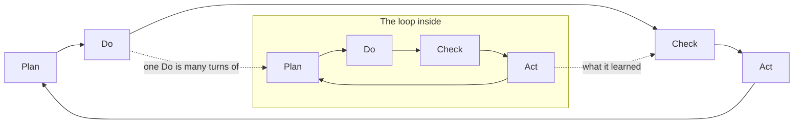

# Loops in loops: building software in a dark factory, by PDCA

In an AI software factory, agents write, test and review the code, while people design the
factory and steer it. This note explains it as loops. Every loop turns Deming's four phases:
plan, do, check, act. The loops sit inside each other, two of them run across all the others like
the Olympic rings, and above the whole thing one management loop looks at the factory itself.

## What a dark factory is

A dark factory runs with the lights off: nobody stands at the line, because the line checks
itself. People design the line, set its standards and look at what comes out. The hardest part
is not the building but the controls: the tests, reviews and checks that let a loop trust its
own output.

## One loop: plan, do, check, act

Every loop goes round Deming's circle, the one Shewhart drew first. It plans what to change, does
it, checks the result against the plan, and acts on what the check found: keep what worked as
the standard, send back what didn't, and carry the lesson into the next plan. Only the size
changes.

- **Plan:** what to make and how we will know it works, the check written before the work.
- **Do:** build it and put it where it can be used.
- **Check:** compare the result with the plan; this is where a loop earns its trust.
- **Act:** keep, fix or drop, and record why, so the next turn starts from the new standard.

Deming later preferred "study" to "check", to stress learning over inspection. Both fit here: a
loop checks where a test decides, and studies where a person judges.

We size the loops in **AI time**: AI minutes, AI days, AI weeks. An AI day is the work a person
would call a day's work, but an agent gets through it in an hour or a night. A capability of a
few AI days is built overnight; a module of AI weeks takes days on the clock. The loops that need
a person, acceptance, the specs, the management loop, still run in human time. So the factory's
speed is set less by how fast agents do the work than by how fast people check it.

A loop is **dark** when it goes round without a person. That needs an exact test at Check, and an
Act that writes down what the next turn needs to start cold. The small loops go dark first,
because their check is cheap and exact. The large loops stay lit longer, because their check is
judgement: is this useful, is this the right next thing, does the shape still hold.

## Loops in loops

The Do phase of every loop is a whole run of the loop inside it. Doing a capability is turning its
tasks; doing a module is turning its capabilities. So each inner loop goes round many times while
its outer loop goes round once, and what an inner loop learns at Act feeds its outer loop's Check.

The **task loop** turns in AI minutes. It plans by writing the test first and does the smallest
code that passes. It checks that every test is green, and acts by refactoring and committing on
green.

The **capability loop** turns in AI days. It plans with a brief and a design, and does its tasks
until the capability is pushed, ready to try. It checks with a review and then a person's
acceptance, and acts by sending findings back to Do and follow-ups to the register.

The **module loop** turns in AI weeks. It plans with its scope and register, and does its
capabilities until they are released to users. It checks how they are used and what the register
of follow-ups holds, and acts by reordering the plan: keep growing, or close.

The **architecture loop** turns in AI months. It plans with the decisions and the catalog, and does
its modules, built in that shape. It checks with a checkpoint that finds the drift, and acts by
fixing the drift or recording a new decision.

### Task loop

Plan is the test, Do is the code, Check is the suite, Act is the refactor and a green commit. The
check is exact, so this loop runs fully dark. An agent works one bounded slice at a time and never
leaves the build red.

### Capability loop

One outcome a person can use. The plan is a brief and a design; Do is the task list, pushed where
people can try it; Check is a review and acceptance; Act sends findings back to Do, files the
follow-ups and records what was decided. This is the loop to make dark first on purpose: delegated
gates, a reviewer agent that reads the design and the diff cold, and findings that send the work
back. What stays with a person is acceptance: "yes, this is what I meant".

### Module loop

A feature area that grows one capability at a time. Its plan is its scope and its register of
follow-ups, which every new brief reads first. Act decides what comes next: reorder, keep growing,
or close like a project. Building an empty skeleton first, with pages and navigation but no
behaviour, is the module's plan made concrete before the capabilities fill it.

### Architecture loop

The plan is the recorded decisions; Do is everything the modules add; Check is a checkpoint every
few capabilities that reviews the whole codebase for drift; Act fixes the drift or records a new
decision that becomes the standard. One rule matters most: an unattended run may reuse an approved
architecture choice, but never make a new one. This loop stays lit.

## The rings that run across

Two loops don't nest. They join the same phase of every level, and turn at their own pace.

**The specs loop** joins the Plan phases. Intent is worked out with people, outside any single
loop, and feeds a module's scope, a capability's brief and a task's test. What any level learns at
Act can change the spec, and a changed spec can reach into a capability mid-Do.

**The deployment loop** joins the end of Do to Check. Each capability is pushed when it stands;
people use a copy while the factory keeps building; a release brings in more users. What they find
comes back at Act: as tasks, as follow-ups in a register, or as a change to the spec.

The two rings cross each other and every nested loop, like the Olympic rings. That is why a loop's
state must live in files, never in a chat: each crossing point is a file, such as a brief, a
design, a register entry or a "how to try this".

## Above it all: the management loop

One loop doesn't build the product at all. The management loop, the SDLC loop, looks at the whole
factory: the nested loops, the two rings and the people in them. Its product is the way of working,
and it is PDCA in Deming's own sense: improving the system, not the output.

- **Plan:** the method itself, written down: the phases, the gates, the rules for what may run
  unattended.
- **Do:** the skills, agents, templates, checks and permissions that carry the method, pinned into
  each run so its evidence can be traced back.
- **Check:** the evidence the runs left: where they stopped, which gates waited for a person, what
  was reworked, which records grew without being read, which instructions were worked around.
- **Act:** a new version of the method: keep what helped as the standard, drop what was worked
  around.

It turns slowly, every couple of dozen capabilities, and it is the one loop that is never dark.
This is where people work most: not on the product, but on the line.

## The roles in the factory

| Role | Runs as | Does |
| --- | --- | --- |
| Orchestrator | The main conversation | Turns the loops, passes gates, asks people |
| Specialists | Subagents | Plan or do one bounded piece, return evidence |
| Reviewers | Subagents, starting cold | Check as a colleague would |

Every gate is a Check with three outcomes at Act: pass, pass with follow-ups, stop. A gate passed
without a person is recorded as delegated, and people confirm or reopen it later.

## Where the light stays on

The factory gets faster each time a Check moves from "a person approves" to "the test decides".
The light stays on where the check is taste or direction: accepting the product, choosing the next
plan, a new architecture choice, anything that spends money or deletes data. That is not a gap in
the factory; it is people's job in it.

## Open questions

- Should every module loop close? Proposal: let the kind of module decide; a migration closes, a
  product area keeps growing.
- Is the deployment loop fast enough? Proposal: measure the time from "done, awaiting acceptance"
  to accepted, at each turn of the management loop.
- Can the specs loop run partly dark? Proposal: not for a product's direction; perhaps when the
  spec is an existing system being rewritten.
- Check or study? Proposal: "check" where a test decides, "study" where a person judges; one word
  in the diagrams.
