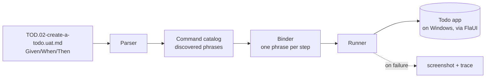

# One Todo UAT, end to end

This walks through **a single UAT** from
[tests/Brinell.Samples.Todo.Uat](tests/Brinell.Samples.Todo.Uat) so you can see how a
plain-Markdown scenario becomes something Brinell actually runs against the app.

The scenario we follow is **TOD.02.3 — "A todo needs a title"** from
[todo-user-journeys.md](tests/Brinell.Samples.Todo.Uat/todo-user-journeys.md). In words:
adding a todo with a blank title must show *"Title is required"* and must not save.

---

## 1. The shape of a UAT

A UAT is not code. It is two Markdown files, plus a small project that points them at a
running app:

| File | Job |
| --- | --- |
| `uat.config.md` | Where the app is, which assemblies hold the pages and controls, how to report. One per test project. |
| `Scenarios/*.uat.md` | The executable scenarios themselves, in `Given / When / Then`. |
| `Runtime/*.cs` | The fixture, the xUnit collection and the scenario test class. Written once. |

Brinell reads the scenario, matches each line to a **phrase**, and calls the matching
**page object** method against the running app. Nothing is generated to `.cs`; the
Markdown *is* the test.



---

## 2. The scenario file

One file per journey. [`Scenarios/TOD.02-create-a-todo.uat.md`](tests/Brinell.Samples.Todo.Uat/Scenarios/TOD.02-create-a-todo.uat.md)
holds every UAT subtask of TOD.02; here is its header and TOD.02.3:

````markdown
# UAT: TOD.02 Create a todo

## Metadata

| Field | Value |
| --- | --- |
| App | Brinell.Samples.Todo.App |
| Area | Create |
| Target | MAUI |
| Journey | TOD.02 |
| TestData | one-todo |
| Tags | maui, create |

## Background

```gherkin
Given I am on the Todo List page
When I tap Add
Then I should be on the Todo Edit page
```

@TOD.02.3 @smoke @maui @create @validation
## Scenario Outline: TOD.02.3 An empty or whitespace title shows "Title is required" and does not save

```gherkin
When I set Title to <title>
And I tap Save
Then Title Error should contain "Title is required"
And I should be on the Todo Edit page
And the database should not have a todo with a blank title
And the database should have todos
  | Title    | SyncState |
  | -------- | --------- |
  | Buy milk | Synced    |
```

### Examples

| title |
| --- |
| "" |
| "   " |
````

Notes on why each part is there:

- **`# UAT: <title>`** — exactly one per file; it names the journey.
- **`## Metadata`** — the traceable header. `Journey: TOD.02` ties the file to the checklist;
  `TestData: one-todo` is the starting data the app is launched on (one synced todo, "Buy milk").
- **`## Background`** — steps put in front of every scenario in the file.
- **`@TOD.02.3 @smoke ...`** — the tag line, **immediately above** the scenario heading. The
  subtask id is both a tag and the start of the heading, so reports and screenshots carry it.
- **`Scenario Outline` + `Examples`** — one run per row; the quotes keep the whitespace title.
- **The steps** — each starts with `Given/When/Then/And/But`. `And` inherits the previous
  keyword, and a `When` after a `Then` is fine: the scenario alternates as the user does. The
  `the database should ...` steps read the app's SQLite file and compare the listed columns.
- **Fenced blocks** — the ```` ```gherkin ```` fences are only for rendering; the parser ignores them.

---

## 3. How each step binds

Every step matches exactly one phrase. The phrase decides which page object method runs:

| Step | Phrase | What runs |
| --- | --- | --- |
| `Given I am on the Todo List page` | `I am on the {page} page` | Opens/asserts the page, sets it current |
| `When I tap Add` | `I tap {control}` | `AddButton.Click()` |
| `Then I should be on the Todo Edit page` | `I should be on the {page} page` | Asserts the page, sets it current |
| `When I clear Title` | `I clear {control}` | `Title.Clear()` |
| `And I tap Save` | `I tap {control}` | `SaveButton.Click()` |
| `Then Title Error should be visible` | `{control} should be visible` | `TitleError.AssertVisible(true)` |
| `And Title Error should contain "Title is required"` | `{control} should contain {value}` | `TitleError.AssertTextContains(...)` |

Those control phrases are not a list someone maintains. Each is a `[UatWhen]` or `[UatThen]` attribute on
the `Brinell.Core` interface method it calls — `I clear {control}` sits on
`IEditableTextControlObject.Clear`, `{control} should be visible` on
`IElementObject.AssertVisible` — and the engine discovers them by reflection
([AD-011](../../.docs/decisions/ad-011-uat-vocabulary-is-attribute-declared.md)). Only the
three page verbs (`I am on the …`, `I should be on the …`, `I should see …`) are the
engine's own.

The important idea: **"Add", "Title", "Save", "Title Error"** are not string lookups
against the screen. They are *names of members on the page object*. The runtime has a
`TodoListPage` and a `TodoEditPage` (in
[tests/Brinell.Samples.Todo.UITests/Pages](tests/Brinell.Samples.Todo.UITests/Pages)), and
their members provide the names:

```csharp
// TodoListPage.cs — the Add toolbar button
public ToolbarButton<AppRoot> AddButton => new(_appRoot, Locator.ByAccessibilityId("TodoList_Add"));

// TodoEditPage.cs — the title and its error label
public Entry<SectionCard<TodoEditPage>> Title      => BasicsCard.Entry("TodoEdit_Title");
public Label<SectionCard<TodoEditPage>> TitleError => BasicsCard.Label("TodoEdit_TitleError");
```

With `AllowNameInference` on, `AddButton` → **Add**, `Title` → **Title**, `TitleError` →
**Title Error**, `TodoListPage` → **Todo List**. Where inference does not reach — a custom
component type such as `TodoStatus` — pin the name:

```csharp
[UatName("Status")]
public TodoStatus<TodoEditPage> Status => new(this, "TodoEdit_Status");
```

So the chain for one step is:

```text
"And Title Error should contain \"Title is required\""
   -> phrase   {control} should contain {value}   ([UatThen] on ITextControlObject.AssertTextContains)
   -> control  "Title Error"  == TodoEditPage.TitleError
   -> id       TodoEdit_TitleError  (from the XAML)
   -> call     AssertTextContains("Title is required")
```

The AutomationIds (`TodoEdit_Title`, `TodoEdit_TitleError`) come from the app XAML in
[src/Brinell.Samples.Todo.App/Pages/TodoEditPage.xaml](src/Brinell.Samples.Todo.App/Pages/TodoEditPage.xaml).
That is the anchor that survives rebuilds — the page object binds to the id, the scenario
binds to the page object's name.

---

## 4. A verb the framework does not have

Cycling the status with **Next** is Todo's own behaviour, so Todo declares its own verb: a
`[UatWhen]` on the method of the ControlObject that performs it
([`TodoStatus.tpl.cs`](tests/Brinell.Samples.Todo.UITests/Controls/TodoStatus.tpl.cs)).

```csharp
[UatWhen("I advance {control} to {value}")]
public TodoStatus<TScope> AdvanceTo(string? expected, int? timeoutMs = null) { ... }

[UatThen("{control} should show status {value}")]
public TodoStatus<TScope> AssertShowsStatus(string? expected, ...) { ... }
```

No registration, no catalog edit: the attribute *is* the registration, and
[`TOD.05-change-status.uat.md`](tests/Brinell.Samples.Todo.Uat/Scenarios/TOD.05-change-status.uat.md)
reads

```markdown
When I advance Status to "Done"
Then Status should show status "Done"
```

The same move gives the list its row assertion — `[UatThen]` on `TodoList.AssertRow`
produces `Then Todos should have todo "Write the report"`.

---

## 5. The config that points at the Todo app

[`uat.config.md`](tests/Brinell.Samples.Todo.Uat/uat.config.md):

```markdown
## Runtime

| Field | Value |
| --- | --- |
| Target | MAUI |
| Fixture | FlaUI |
| AppPath | ../../src/Brinell.Samples.Todo.App/bin/Debug/net10.0-windows10.0.19041.0/win10-x64/Brinell.Samples.Todo.App.exe |
| WorkingDirectory | ../../../.. |

## Assemblies

| Kind | Assembly |
| --- | --- |
| Pages | ../Brinell.Samples.Todo.UITests/bin/Debug/net10.0-windows/Brinell.Samples.Todo.UITests.dll |
| Controls | ../../../../srcnew/Brinell.Maui/bin/Debug/net10.0/Brinell.Maui.dll |
| Commands | ../../../../srcnew/Brinell.Uat/bin/Debug/net10.0/Brinell.Uat.dll |

## Discovery

| Field | Value |
| --- | --- |
| RequireExplicitUatAttributes | false |
| AllowNameInference | true |
```

- **`Pages`** is the assembly carrying `TodoListPage` / `TodoEditPage` — the source of the
  control names, and of Todo's custom `[UatWhen]` / `[UatThen]` verbs.
- **`AllowNameInference = true`** is why `AddButton` works as **Add** with no attribute.
- **`Fixture = FlaUI`** is the Windows head. `TodoUatScenarioTests` asserts this at load
  time, so a config pointed at the wrong driver fails before any scenario runs.

---

## 6. The fixture: the same hermetic app the UI tier uses

The UAT project reuses tier 3's fixture rather than standing up its own app.
[`TodoUatFixture`](tests/Brinell.Samples.Todo.Uat/Runtime/TodoUatFixture.cs) adds the two
things the UAT runtime needs:

```csharp
[TestModuleScan(typeof(TodoListPage), NamespacePrefix = "Brinell.Samples.Todo.UITests.Pages")]
public sealed class TodoUatFixture : TodoAppFixture
{
    public TodoUatFixture()
    {
        Composition = TestComposition.ForFixture(this, services =>
            services.AddSingleton<IMauiTestContext>(Context));
    }

    protected override string ScenarioName => "three-todos";

    public TestComposition Composition { get; }
}
```

`Composition` is where the runtime finds the page objects and how it constructs them. The
backend is WireMock and the database is seeded with the `three-todos` scenario, exactly as
in tier 3 — a UAT here is hermetic, not a smoke test against a real server.

Scenarios share one app process, so
[`TodoUatScenarioTests`](tests/Brinell.Samples.Todo.Uat/Runtime/TodoUatScenarioTests.cs)
resets it between them:

```csharp
protected override void BeforeScenario(UatBoundScenario scenario) => Fixture.StartTest();
```

Online again, backend back to `three-todos`, list on screen. That is what keeps the four
scenarios independent of order and of each other's edits.

---

## 7. What happens when it runs

1. The collection fixture launches `Brinell.Samples.Todo.App.exe` and the WireMock backend.
2. `BeforeScenario` resets the app to the seeded list.
3. `Given I am on the Todo List page` waits for the list to be on screen (the page object's
   own readiness gate), not a fixed sleep.
4. `When I tap Add` clicks the toolbar Add; the edit page opens.
5. `Then I should be on the Todo Edit page` confirms the navigation before going on.
6. `When I clear Title` empties the title entry; `And I tap Save` presses Save. Validation
   refuses it and shows the error.
7. The two `Then` steps assert the error label is visible and says "Title is required".

If any step fails, the runner stops that scenario, captures a screenshot and a runtime
trace (`ScreenshotOnFailure` / `IncludeRuntimeTrace`), and reports the failing step.

---

## 8. Running it

From `samples/Todo`, with no other UI or UAT process running:

```bash
# The UAT project launches the app, so build the app first.
dotnet build src/Brinell.Samples.Todo.App -f net10.0-windows10.0.19041.0
dotnet test tests/Brinell.Samples.Todo.Uat
```

---

## 9. Why this is worth it

- A product owner can read `TOD.02-create-a-todo.uat.md` and sign off on it — there is no C#
  to understand.
- It runs deterministically against the real app; no LLM in the loop at run time.
- It stays traceable: `TOD.02.3` in the journey checklist → this `.uat.md` → green/red.

When a scenario outgrows the phrase vocabulary, there are two escapes before giving up on
Markdown: a `[UatWhen]` or `[UatThen]` on the control that does the work (§4), or one on a
fixture for something no control owns. Only past those does the scenario drop to a `.cs`
page-object test — the hatch described in
[.my/uat/rethinking-uat.md](../../.my/uat/rethinking-uat.md).

The same file shape also carries a journey across several apps. With an `Apps` table (or a shared
`apps.md`), a step names who does it and runs on that person's app, so a sync between Daan's
Windows app and Finn's browser reads as what they do:

```gherkin
When Daan taps Sync
Then the server should have received the todo "Pack for the trip" from Daan
When Finn taps Sync
Then Todos should have todo "Pack for the trip"
```

See `tests/Brinell.Samples.Todo.Mixed.Uat/Scenarios/TOD.07-mixed.uat.md` and
[AD-015](../../.docs/decisions/ad-015-a-steps-subject-picks-its-app.md).

---

## Reference

- Journey checklist: [todo-user-journeys.md](tests/Brinell.Samples.Todo.Uat/todo-user-journeys.md)
- Pyramid backbone: [journeys.md](journeys.md)
- Config and file shape: [docs/guides/uat-template-guide.md](../../docs/guides/uat-template-guide.md)
- Phrase catalog and binding: [docs/guides/uat-phrases-and-flows.md](../../docs/guides/uat-phrases-and-flows.md)
- Why the vocabulary is attribute-declared: [AD-011](../../.docs/decisions/ad-011-uat-vocabulary-is-attribute-declared.md)
- Several apps in one scenario: [AD-015](../../.docs/decisions/ad-015-a-steps-subject-picks-its-app.md)
- Todo page objects: [tests/Brinell.Samples.Todo.UITests/Pages](tests/Brinell.Samples.Todo.UITests/Pages)
